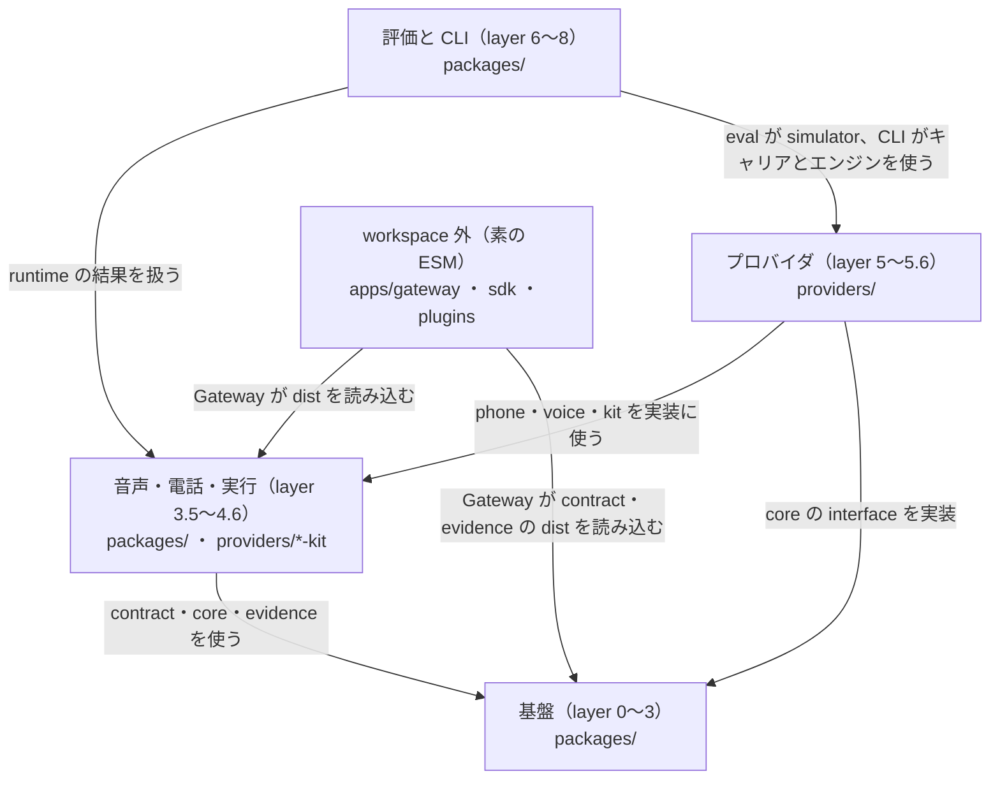

# dependency-map

[解析トップへ戻る](../README.md)

# パッケージの依存方向

scripts/check-deps.mjs（pnpm lint:deps）が強制する層の構成。各パッケージは自分より低い層にだけ依存でき、同じ層どうしも禁止される。矢印は「依存する側 → 依存される側」。

## 制約

- package.json の dependencies / peerDependencies と、src/*.ts（テスト以外）の import の両方を検査する。
- 層の表にない新しいパッケージはエラーになる（追加時は check-deps.mjs に登録する）。
- packages/* と providers/* は sdk・plugins・apps/gateway を import してはいけない。

## 補足

層の番号は scripts/check-deps.mjs の LAYER 表の値。

## 要素

### foundation

contract（0）→ evidence（1）→ core（2）→ scenario（3）。下の層ほど他に依存しない。

[詳細な図と説明を見る](foundation/README.md)

### outside-workspace

pnpm workspace の外にあり、相対パスの import で検査される。

[詳細な図と説明を見る](outside-workspace/README.md)

### provider-packages

layer 5 は単体の実装、5.5 はそれらを組み合わせる実装、5.6 は 5.5 を再利用する実装。同じ層どうしは import できない。

[詳細な図と説明を見る](provider-packages/README.md)

### top

replay と eval（6）、CLI（8）。

[詳細な図と説明を見る](top/README.md)

### voice-phone-runtime

audio-kit（3.5）→ voice（3.8）→ runtime（4）→ brain-kit・voice-kit（4.5）→ phone（4.6）。

[詳細な図と説明を見る](voice-phone-runtime/README.md)
