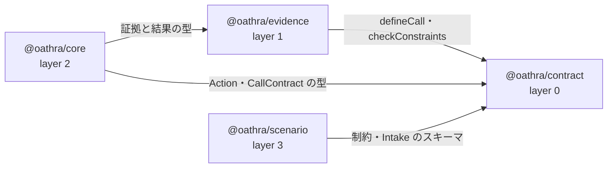

# dependency-map/foundation

[解析トップへ戻る](../README.md) ・ [ひとつ上へ](../README.md)

contract（0）→ evidence（1）→ core（2）→ scenario（3）。下の層ほど他に依存しない。

## 要素

### contract

依存先: なし（@oathra には依存しない）

[説明を見る](contract/README.md)

### core

依存先: contract、evidence

[説明を見る](core/README.md)

### evidence

依存先: contract

[説明を見る](evidence/README.md)

### scenario

依存先: contract

[説明を見る](scenario/README.md)
