# dependency-map/group-1

[解析トップへ戻る](../../README.md)

このグループは表示用の区切りです。独立した実行モジュールではありません。

```mermaid
graph TD
    n-apps-gateway-server-mjs-325f1b["server.mjs\napps/gateway/server.mjs"]
    n-plugins-calendar-index-mjs-1f9f11["index.mjs\nplugins/calendar/index.mjs"]
    n-plugins-call-index-mjs-a8d06d["index.mjs\nplugins/call/index.mjs"]
    n-sdk-gateway-client-connection-file-mjs-898eb1["connection-file.mjs\nsdk/gateway-client/connection-file.mjs"]
    n-apps-gateway-lib-phone-ui-mjs-f41ef2["phone-ui.mjs\napps/gateway/lib/phone-ui.mjs"]
    n-apps-gateway-lib-agent-phone-mjs-0afb17["agent-phone.mjs\napps/gateway/lib/agent-phone.mjs"]
    n-apps-gateway-lib-practice-mjs-0c3b76["practice.mjs\napps/gateway/lib/practice.mjs"]
    n-apps-gateway-lib-phone-service-mjs-505dd0["phone-service.mjs\napps/gateway/lib/phone-service.mjs"]
```

## 要素の説明

### n-apps-gateway-lib-agent-phone-mjs-0afb17

確認済みファイル: `apps/gateway/lib/agent-phone.mjs`

解析: 字句抽出。静的なimport／export参照です。関数の実行順序やHTTP通信は表していません。

宣言: `phoneGrantDefaults`, `connectPhoneAgent`, `agentPhoneConnection`, `grantPhone`, `grantPhoneTx`, `revokePhoneGrant`, `liveGrant`, `checkPhoneDelegation`, `ownedDispatch`, `agentPhoneResult`, `dispatchPhone`, `readAgentPhone`, `cancelAgentPhone`

- `node:crypto` → 外部・標準ライブラリ・別名など。ローカル対応先は未確定
- `../../../packages/contract/dist/index.js` → 外部・標準ライブラリ・別名など。ローカル対応先は未確定
- `./phone-service.mjs` → `apps/gateway/lib/phone-service.mjs`（内容確認済み）
- `./service.mjs` → `apps/gateway/lib/service.mjs`（一覧確認・内容未読）
- `./security.mjs` → `apps/gateway/lib/security.mjs`（一覧確認・内容未読）

[詳細な図と説明を見る](n-apps-gateway-lib-agent-phone-mjs-0afb17/README.md)

### n-apps-gateway-lib-phone-service-mjs-505dd0

確認済みファイル: `apps/gateway/lib/phone-service.mjs`

解析: 字句抽出。静的なimport／export参照です。関数の実行順序やHTTP通信は表していません。

宣言: `voiceDetails`, `recommend`, `phoneReadiness`, `phoneRecord`, `phoneCalendar`, `resolvePhoneTarget`, `prepareManagedPhone`, `carrierChargeTotals`

- `../../../packages/core/dist/index.js` → 外部・標準ライブラリ・別名など。ローカル対応先は未確定
- `../../../packages/contract/dist/index.js` → 外部・標準ライブラリ・別名など。ローカル対応先は未確定
- `./security.mjs` → `apps/gateway/lib/security.mjs`（一覧確認・内容未読）
- `node:fs` → 外部・標準ライブラリ・別名など。ローカル対応先は未確定
- `./paths.mjs` → `apps/gateway/lib/paths.mjs`（一覧確認・内容未読）
- `./prerelease.mjs` → `apps/gateway/lib/prerelease.mjs`（一覧確認・内容未読）

[詳細な図と説明を見る](n-apps-gateway-lib-phone-service-mjs-505dd0/README.md)

### n-apps-gateway-lib-phone-ui-mjs-f41ef2

確認済みファイル: `apps/gateway/lib/phone-ui.mjs`

解析: 字句抽出。静的なimport／export参照です。関数の実行順序やHTTP通信は表していません。

宣言: `phonePage`

- `node:fs` → 外部・標準ライブラリ・別名など。ローカル対応先は未確定
- `./paths.mjs` → `apps/gateway/lib/paths.mjs`（一覧確認・内容未読）

[詳細な図と説明を見る](n-apps-gateway-lib-phone-ui-mjs-f41ef2/README.md)

### n-apps-gateway-lib-practice-mjs-0c3b76

確認済みファイル: `apps/gateway/lib/practice.mjs`

解析: 字句抽出。静的なimport／export参照です。関数の実行順序やHTTP通信は表していません。

宣言: `configurePractice`, `practiceBrains`, `brainFor`, `keep`, `scenarios`, `practiceList`, `settledFrom`, `practiceRun`, `sweep`, `ownPlay`, `practicePlayStart`, `practicePlayState`, `practicePlayReply`, `practicePlayHangup`, `practiceRecords`, `statTime`, `practiceRecord`

- `node:url` → 外部・標準ライブラリ・別名など。ローカル対応先は未確定
- `node:fs` → 外部・標準ライブラリ・別名など。ローカル対応先は未確定
- `node:path` → 外部・標準ライブラリ・別名など。ローカル対応先は未確定
- `./security.mjs` → `apps/gateway/lib/security.mjs`（一覧確認・内容未読）
- `./paths.mjs` → `apps/gateway/lib/paths.mjs`（一覧確認・内容未読）

[詳細な図と説明を見る](n-apps-gateway-lib-practice-mjs-0c3b76/README.md)

### n-apps-gateway-server-mjs-325f1b

確認済みファイル: `apps/gateway/server.mjs`

解析: 字句抽出。静的なimport／export参照です。関数の実行順序やHTTP通信は表していません。

宣言: `hours`, `number`, `configuration`, `clientIp`, `limitClass`, `body`, `jsonBody`, `oauthForm`, `sendAsset`, `send`, `createGateway`

- `./lib/phone-ui.mjs` → `apps/gateway/lib/phone-ui.mjs`（内容確認済み）
- `./lib/agent-phone.mjs` → `apps/gateway/lib/agent-phone.mjs`（内容確認済み）
- `./lib/practice.mjs` → `apps/gateway/lib/practice.mjs`（内容確認済み）
- `../../packages/core/dist/index.js` → 外部・標準ライブラリ・別名など。ローカル対応先は未確定
- `./lib/phone-service.mjs` → `apps/gateway/lib/phone-service.mjs`（内容確認済み）
- `node:http` → 外部・標準ライブラリ・別名など。ローカル対応先は未確定
- `node:fs` → 外部・標準ライブラリ・別名など。ローカル対応先は未確定
- `node:url` → 外部・標準ライブラリ・別名など。ローカル対応先は未確定
- `node:path` → 外部・標準ライブラリ・別名など。ローカル対応先は未確定
- `./lib/store.mjs` → `apps/gateway/lib/store.mjs`（内容確認済み）
- `./lib/browser-session.mjs` → `apps/gateway/lib/browser-session.mjs`（内容確認済み）
- `./lib/alerts.mjs` → `apps/gateway/lib/alerts.mjs`（内容確認済み）
- `./lib/schedules.mjs` → `apps/gateway/lib/schedules.mjs`（内容確認済み）
- `./lib/batches.mjs` → `apps/gateway/lib/batches.mjs`（内容確認済み）
- `./lib/team.mjs` → `apps/gateway/lib/team.mjs`（内容確認済み）
- `./lib/public-accounts.mjs` → `apps/gateway/lib/public-accounts.mjs`（内容確認済み）
- `./lib/purchases.mjs` → `apps/gateway/lib/purchases.mjs`（内容確認済み）
- `./lib/prerelease.mjs` → `apps/gateway/lib/prerelease.mjs`（一覧確認・内容未読）
- `./lib/mcp-oauth.mjs` → `apps/gateway/lib/mcp-oauth.mjs`（一覧確認・内容未読）
- `./lib/mcp-sales.mjs` → `apps/gateway/lib/mcp-sales.mjs`（一覧確認・内容未読）
- `./lib/service.mjs` → `apps/gateway/lib/service.mjs`（一覧確認・内容未読）
- `./lib/channels.mjs` → `apps/gateway/lib/channels.mjs`（一覧確認・内容未読）
- `./lib/plugins.mjs` → `apps/gateway/lib/plugins.mjs`（一覧確認・内容未読）
- `../../sdk/plugin-kit/index.mjs` → `sdk/plugin-kit/index.mjs`（一覧確認・内容未読）
- `./lib/worker.mjs` → `apps/gateway/lib/worker.mjs`（一覧確認・内容未読）
- `./lib/followups.mjs` → `apps/gateway/lib/followups.mjs`（一覧確認・内容未読）
- `./lib/phone.mjs` → `apps/gateway/lib/phone.mjs`（一覧確認・内容未読）
- `./lib/billing.mjs` → `apps/gateway/lib/billing.mjs`（一覧確認・内容未読）
- `./lib/security.mjs` → `apps/gateway/lib/security.mjs`（一覧確認・内容未読）
- `./lib/paths.mjs` → `apps/gateway/lib/paths.mjs`（一覧確認・内容未読）

[詳細な図と説明を見る](n-apps-gateway-server-mjs-325f1b/README.md)

### n-plugins-calendar-index-mjs-1f9f11

確認済みファイル: `plugins/calendar/index.mjs`

解析: 字句抽出。静的なimport／export参照です。関数の実行順序やHTTP通信は表していません。

宣言: `create`

- `../../sdk/capability-sdk/index.mjs` → `sdk/capability-sdk/index.mjs`（一覧確認・内容未読）
- `../_shared/http.mjs` → `plugins/_shared/http.mjs`（一覧確認・内容未読）

[詳細な図と説明を見る](n-plugins-calendar-index-mjs-1f9f11/README.md)

### n-plugins-call-index-mjs-a8d06d

確認済みファイル: `plugins/call/index.mjs`

解析: 字句抽出。静的なimport／export参照です。関数の実行順序やHTTP通信は表していません。

宣言: `create`

- `../../sdk/capability-sdk/index.mjs` → `sdk/capability-sdk/index.mjs`（一覧確認・内容未読）

[詳細な図と説明を見る](n-plugins-call-index-mjs-a8d06d/README.md)

### n-sdk-gateway-client-connection-file-mjs-898eb1

確認済みファイル: `sdk/gateway-client/connection-file.mjs`

解析: 字句抽出。静的なimport／export参照です。関数の実行順序やHTTP通信は表していません。

宣言: `readConnectionFile`

- `node:fs` → 外部・標準ライブラリ・別名など。ローカル対応先は未確定
- `node:path` → 外部・標準ライブラリ・別名など。ローカル対応先は未確定
- `./index.mjs` → `sdk/gateway-client/index.mjs`（一覧確認・内容未読）

[詳細な図と説明を見る](n-sdk-gateway-client-connection-file-mjs-898eb1/README.md)

