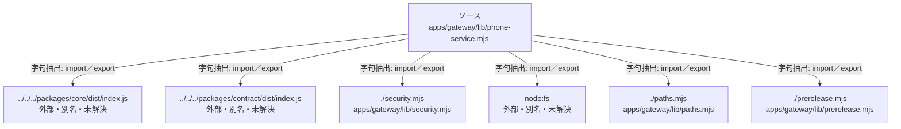

# dependency-map/group-1/n-apps-gateway-lib-phone-service-mjs-505dd0

[解析トップへ戻る](../../../README.md)

確認済みファイル: `apps/gateway/lib/phone-service.mjs`

解析: 字句抽出。静的なimport／export参照です。関数の実行順序やHTTP通信は表していません。

宣言: `voiceDetails`, `recommend`, `phoneReadiness`, `phoneRecord`, `phoneCalendar`, `resolvePhoneTarget`, `prepareManagedPhone`, `carrierChargeTotals`

- `../../../packages/core/dist/index.js` → 外部・標準ライブラリ・別名など。ローカル対応先は未確定
- `../../../packages/contract/dist/index.js` → 外部・標準ライブラリ・別名など。ローカル対応先は未確定
- `./security.mjs` → `apps/gateway/lib/security.mjs`（一覧確認・内容未読）
- `node:fs` → 外部・標準ライブラリ・別名など。ローカル対応先は未確定
- `./paths.mjs` → `apps/gateway/lib/paths.mjs`（一覧確認・内容未読）
- `./prerelease.mjs` → `apps/gateway/lib/prerelease.mjs`（一覧確認・内容未読）

## 要素の説明

### n-node-fs-a15b7d

参照名: `node:fs`

ローカルのソース対応先を確定できませんでした。外部ライブラリ、標準ライブラリ、型別名などを区別する追加確認が必要です。

### n-packages-contract-dist-index-js-6a2376

参照名: `../../../packages/contract/dist/index.js`

ローカルのソース対応先を確定できませんでした。外部ライブラリ、標準ライブラリ、型別名などを区別する追加確認が必要です。

### n-packages-core-dist-index-js-6eaf63

参照名: `../../../packages/core/dist/index.js`

ローカルのソース対応先を確定できませんでした。外部ライブラリ、標準ライブラリ、型別名などを区別する追加確認が必要です。

### n-paths-mjs-b64aac

参照名: `./paths.mjs`

対応する実在ソース: `apps/gateway/lib/paths.mjs`。内容は未読。

### n-prerelease-mjs-d3db3a

参照名: `./prerelease.mjs`

対応する実在ソース: `apps/gateway/lib/prerelease.mjs`。内容は未読。

### n-security-mjs-7b9f61

参照名: `./security.mjs`

対応する実在ソース: `apps/gateway/lib/security.mjs`。内容は未読。

### source

`apps/gateway/lib/phone-service.mjs` の内容を確認しました。

