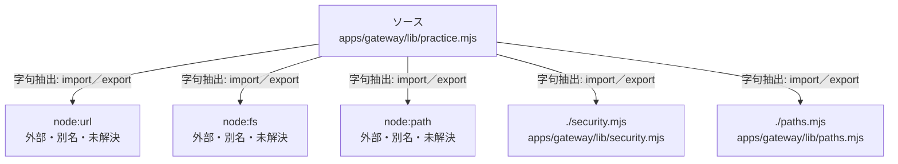

# dependency-map/group-1/n-apps-gateway-lib-practice-mjs-0c3b76

[解析トップへ戻る](../../../README.md)

確認済みファイル: `apps/gateway/lib/practice.mjs`

解析: 字句抽出。静的なimport／export参照です。関数の実行順序やHTTP通信は表していません。

宣言: `configurePractice`, `practiceBrains`, `brainFor`, `keep`, `scenarios`, `practiceList`, `settledFrom`, `practiceRun`, `sweep`, `ownPlay`, `practicePlayStart`, `practicePlayState`, `practicePlayReply`, `practicePlayHangup`, `practiceRecords`, `statTime`, `practiceRecord`

- `node:url` → 外部・標準ライブラリ・別名など。ローカル対応先は未確定
- `node:fs` → 外部・標準ライブラリ・別名など。ローカル対応先は未確定
- `node:path` → 外部・標準ライブラリ・別名など。ローカル対応先は未確定
- `./security.mjs` → `apps/gateway/lib/security.mjs`（一覧確認・内容未読）
- `./paths.mjs` → `apps/gateway/lib/paths.mjs`（一覧確認・内容未読）

## 要素の説明

### n-node-fs-a15b7d

参照名: `node:fs`

ローカルのソース対応先を確定できませんでした。外部ライブラリ、標準ライブラリ、型別名などを区別する追加確認が必要です。

### n-node-path-78811c

参照名: `node:path`

ローカルのソース対応先を確定できませんでした。外部ライブラリ、標準ライブラリ、型別名などを区別する追加確認が必要です。

### n-node-url-d0cb3a

参照名: `node:url`

ローカルのソース対応先を確定できませんでした。外部ライブラリ、標準ライブラリ、型別名などを区別する追加確認が必要です。

### n-paths-mjs-b64aac

参照名: `./paths.mjs`

対応する実在ソース: `apps/gateway/lib/paths.mjs`。内容は未読。

### n-security-mjs-7b9f61

参照名: `./security.mjs`

対応する実在ソース: `apps/gateway/lib/security.mjs`。内容は未読。

### source

`apps/gateway/lib/practice.mjs` の内容を確認しました。

