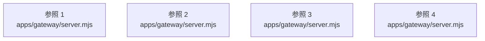

# dependency-map/group-1/n-apps-gateway-server-mjs-325f1b

[解析トップへ戻る](../../../README.md)

確認済みファイル: `apps/gateway/server.mjs`

解析: 字句抽出。静的なimport／export参照です。関数の実行順序やHTTP通信は表していません。

宣言: `hours`, `number`, `configuration`, `clientIp`, `limitClass`, `body`, `jsonBody`, `oauthForm`, `sendAsset`, `send`, `createGateway`

- `./lib/phone-ui.mjs` → `apps/gateway/lib/phone-ui.mjs`（内容確認済み）
- `./lib/agent-phone.mjs` → `apps/gateway/lib/agent-phone.mjs`（内容確認済み）
- `./lib/practice.mjs` → `apps/gateway/lib/practice.mjs`（内容確認済み）
- `../../packages/core/dist/index.js` → 外部・標準ライブラリ・別名など。ローカル対応先は未確定
- `./lib/phone-service.mjs` → `apps/gateway/lib/phone-service.mjs`（内容確認済み）
- `node:http` → 外部・標準ライブラリ・別名など。ローカル対応先は未確定
- `node:fs` → 外部・標準ライブラリ・別名など。ローカル対応先は未確定
- `node:url` → 外部・標準ライブラリ・別名など。ローカル対応先は未確定
- `node:path` → 外部・標準ライブラリ・別名など。ローカル対応先は未確定
- `./lib/store.mjs` → `apps/gateway/lib/store.mjs`（内容確認済み）
- `./lib/browser-session.mjs` → `apps/gateway/lib/browser-session.mjs`（内容確認済み）
- `./lib/alerts.mjs` → `apps/gateway/lib/alerts.mjs`（内容確認済み）
- `./lib/schedules.mjs` → `apps/gateway/lib/schedules.mjs`（内容確認済み）
- `./lib/batches.mjs` → `apps/gateway/lib/batches.mjs`（内容確認済み）
- `./lib/team.mjs` → `apps/gateway/lib/team.mjs`（内容確認済み）
- `./lib/public-accounts.mjs` → `apps/gateway/lib/public-accounts.mjs`（内容確認済み）
- `./lib/purchases.mjs` → `apps/gateway/lib/purchases.mjs`（内容確認済み）
- `./lib/prerelease.mjs` → `apps/gateway/lib/prerelease.mjs`（一覧確認・内容未読）
- `./lib/mcp-oauth.mjs` → `apps/gateway/lib/mcp-oauth.mjs`（一覧確認・内容未読）
- `./lib/mcp-sales.mjs` → `apps/gateway/lib/mcp-sales.mjs`（一覧確認・内容未読）
- `./lib/service.mjs` → `apps/gateway/lib/service.mjs`（一覧確認・内容未読）
- `./lib/channels.mjs` → `apps/gateway/lib/channels.mjs`（一覧確認・内容未読）
- `./lib/plugins.mjs` → `apps/gateway/lib/plugins.mjs`（一覧確認・内容未読）
- `../../sdk/plugin-kit/index.mjs` → `sdk/plugin-kit/index.mjs`（一覧確認・内容未読）
- `./lib/worker.mjs` → `apps/gateway/lib/worker.mjs`（一覧確認・内容未読）
- `./lib/followups.mjs` → `apps/gateway/lib/followups.mjs`（一覧確認・内容未読）
- `./lib/phone.mjs` → `apps/gateway/lib/phone.mjs`（一覧確認・内容未読）
- `./lib/billing.mjs` → `apps/gateway/lib/billing.mjs`（一覧確認・内容未読）
- `./lib/security.mjs` → `apps/gateway/lib/security.mjs`（一覧確認・内容未読）
- `./lib/paths.mjs` → `apps/gateway/lib/paths.mjs`（一覧確認・内容未読）

## 要素の説明

### imports-1

import参照の表示用グループ。

[詳細な図と説明を見る](imports-1/README.md)

### imports-2

import参照の表示用グループ。

[詳細な図と説明を見る](imports-2/README.md)

### imports-3

import参照の表示用グループ。

[詳細な図と説明を見る](imports-3/README.md)

### imports-4

import参照の表示用グループ。

[詳細な図と説明を見る](imports-4/README.md)

