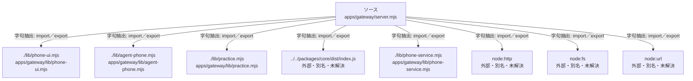

# dependency-map/group-1/n-apps-gateway-server-mjs-325f1b/imports-1

[解析トップへ戻る](../../../../README.md)

import参照の表示用グループ。

## 要素の説明

### n-lib-agent-phone-mjs-2b46c0

参照名: `./lib/agent-phone.mjs`

対応する実在ソース: `apps/gateway/lib/agent-phone.mjs`。内容確認済み。

### n-lib-phone-service-mjs-bc167a

参照名: `./lib/phone-service.mjs`

対応する実在ソース: `apps/gateway/lib/phone-service.mjs`。内容確認済み。

### n-lib-phone-ui-mjs-ec9ee4

参照名: `./lib/phone-ui.mjs`

対応する実在ソース: `apps/gateway/lib/phone-ui.mjs`。内容確認済み。

### n-lib-practice-mjs-438bdb

参照名: `./lib/practice.mjs`

対応する実在ソース: `apps/gateway/lib/practice.mjs`。内容確認済み。

### n-node-fs-a15b7d

参照名: `node:fs`

ローカルのソース対応先を確定できませんでした。外部ライブラリ、標準ライブラリ、型別名などを区別する追加確認が必要です。

### n-node-http-e4ddf5

参照名: `node:http`

ローカルのソース対応先を確定できませんでした。外部ライブラリ、標準ライブラリ、型別名などを区別する追加確認が必要です。

### n-node-url-d0cb3a

参照名: `node:url`

ローカルのソース対応先を確定できませんでした。外部ライブラリ、標準ライブラリ、型別名などを区別する追加確認が必要です。

### n-packages-core-dist-index-js-14a63c

参照名: `../../packages/core/dist/index.js`

ローカルのソース対応先を確定できませんでした。外部ライブラリ、標準ライブラリ、型別名などを区別する追加確認が必要です。

### source

`apps/gateway/server.mjs` の内容を確認しました。

