# dependency-map/group-1/n-apps-gateway-server-mjs-325f1b/imports-2

[解析トップへ戻る](../../../../README.md)

import参照の表示用グループ。

```mermaid
graph TD
    source["ソース\napps/gateway/server.mjs"]
    n-node-path-78811c["node:path\n外部・別名・未解決"]
    source -->|"字句抽出: import／export"| n-node-path-78811c
    n-lib-store-mjs-f9e0c4["./lib/store.mjs\napps/gateway/lib/store.mjs"]
    source -->|"字句抽出: import／export"| n-lib-store-mjs-f9e0c4
    n-lib-browser-session-mjs-292d49["./lib/browser-session.mjs\napps/gateway/lib/browser-session.mjs"]
    source -->|"字句抽出: import／export"| n-lib-browser-session-mjs-292d49
    n-lib-alerts-mjs-b2bd73["./lib/alerts.mjs\napps/gateway/lib/alerts.mjs"]
    source -->|"字句抽出: import／export"| n-lib-alerts-mjs-b2bd73
    n-lib-schedules-mjs-d7ac26["./lib/schedules.mjs\napps/gateway/lib/schedules.mjs"]
    source -->|"字句抽出: import／export"| n-lib-schedules-mjs-d7ac26
    n-lib-batches-mjs-5c2d45["./lib/batches.mjs\napps/gateway/lib/batches.mjs"]
    source -->|"字句抽出: import／export"| n-lib-batches-mjs-5c2d45
    n-lib-team-mjs-b8ac8c["./lib/team.mjs\napps/gateway/lib/team.mjs"]
    source -->|"字句抽出: import／export"| n-lib-team-mjs-b8ac8c
    n-lib-public-accounts-mjs-2774f1["./lib/public-accounts.mjs\napps/gateway/lib/public-accounts.mjs"]
    source -->|"字句抽出: import／export"| n-lib-public-accounts-mjs-2774f1
```

## 要素の説明

### n-lib-alerts-mjs-b2bd73

参照名: `./lib/alerts.mjs`

対応する実在ソース: `apps/gateway/lib/alerts.mjs`。内容確認済み。

### n-lib-batches-mjs-5c2d45

参照名: `./lib/batches.mjs`

対応する実在ソース: `apps/gateway/lib/batches.mjs`。内容確認済み。

### n-lib-browser-session-mjs-292d49

参照名: `./lib/browser-session.mjs`

対応する実在ソース: `apps/gateway/lib/browser-session.mjs`。内容確認済み。

### n-lib-public-accounts-mjs-2774f1

参照名: `./lib/public-accounts.mjs`

対応する実在ソース: `apps/gateway/lib/public-accounts.mjs`。内容確認済み。

### n-lib-schedules-mjs-d7ac26

参照名: `./lib/schedules.mjs`

対応する実在ソース: `apps/gateway/lib/schedules.mjs`。内容確認済み。

### n-lib-store-mjs-f9e0c4

参照名: `./lib/store.mjs`

対応する実在ソース: `apps/gateway/lib/store.mjs`。内容確認済み。

### n-lib-team-mjs-b8ac8c

参照名: `./lib/team.mjs`

対応する実在ソース: `apps/gateway/lib/team.mjs`。内容確認済み。

### n-node-path-78811c

参照名: `node:path`

ローカルのソース対応先を確定できませんでした。外部ライブラリ、標準ライブラリ、型別名などを区別する追加確認が必要です。

### source

`apps/gateway/server.mjs` の内容を確認しました。

