# dependency-map/group-1/n-apps-gateway-server-mjs-325f1b/imports-3

[解析トップへ戻る](../../../../README.md)

import参照の表示用グループ。

```mermaid
graph TD
    source["ソース\napps/gateway/server.mjs"]
    n-lib-purchases-mjs-c1d331["./lib/purchases.mjs\napps/gateway/lib/purchases.mjs"]
    source -->|"字句抽出: import／export"| n-lib-purchases-mjs-c1d331
    n-lib-prerelease-mjs-b53f72["./lib/prerelease.mjs\napps/gateway/lib/prerelease.mjs"]
    source -->|"字句抽出: import／export"| n-lib-prerelease-mjs-b53f72
    n-lib-mcp-oauth-mjs-013236["./lib/mcp-oauth.mjs\napps/gateway/lib/mcp-oauth.mjs"]
    source -->|"字句抽出: import／export"| n-lib-mcp-oauth-mjs-013236
    n-lib-mcp-sales-mjs-27ae08["./lib/mcp-sales.mjs\napps/gateway/lib/mcp-sales.mjs"]
    source -->|"字句抽出: import／export"| n-lib-mcp-sales-mjs-27ae08
    n-lib-service-mjs-a4d297["./lib/service.mjs\napps/gateway/lib/service.mjs"]
    source -->|"字句抽出: import／export"| n-lib-service-mjs-a4d297
    n-lib-channels-mjs-292d38["./lib/channels.mjs\napps/gateway/lib/channels.mjs"]
    source -->|"字句抽出: import／export"| n-lib-channels-mjs-292d38
    n-lib-plugins-mjs-6f916a["./lib/plugins.mjs\napps/gateway/lib/plugins.mjs"]
    source -->|"字句抽出: import／export"| n-lib-plugins-mjs-6f916a
    n-sdk-plugin-kit-index-mjs-391e93["../../sdk/plugin-kit/index.mjs\nsdk/plugin-kit/index.mjs"]
    source -->|"字句抽出: import／export"| n-sdk-plugin-kit-index-mjs-391e93
```

## 要素の説明

### n-lib-channels-mjs-292d38

参照名: `./lib/channels.mjs`

対応する実在ソース: `apps/gateway/lib/channels.mjs`。内容は未読。

### n-lib-mcp-oauth-mjs-013236

参照名: `./lib/mcp-oauth.mjs`

対応する実在ソース: `apps/gateway/lib/mcp-oauth.mjs`。内容は未読。

### n-lib-mcp-sales-mjs-27ae08

参照名: `./lib/mcp-sales.mjs`

対応する実在ソース: `apps/gateway/lib/mcp-sales.mjs`。内容は未読。

### n-lib-plugins-mjs-6f916a

参照名: `./lib/plugins.mjs`

対応する実在ソース: `apps/gateway/lib/plugins.mjs`。内容は未読。

### n-lib-prerelease-mjs-b53f72

参照名: `./lib/prerelease.mjs`

対応する実在ソース: `apps/gateway/lib/prerelease.mjs`。内容は未読。

### n-lib-purchases-mjs-c1d331

参照名: `./lib/purchases.mjs`

対応する実在ソース: `apps/gateway/lib/purchases.mjs`。内容確認済み。

### n-lib-service-mjs-a4d297

参照名: `./lib/service.mjs`

対応する実在ソース: `apps/gateway/lib/service.mjs`。内容は未読。

### n-sdk-plugin-kit-index-mjs-391e93

参照名: `../../sdk/plugin-kit/index.mjs`

対応する実在ソース: `sdk/plugin-kit/index.mjs`。内容は未読。

### source

`apps/gateway/server.mjs` の内容を確認しました。

