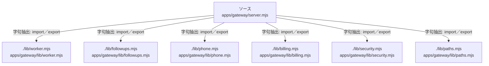

# dependency-map/group-1/n-apps-gateway-server-mjs-325f1b/imports-4

[解析トップへ戻る](../../../../README.md)

import参照の表示用グループ。

## 要素の説明

### n-lib-billing-mjs-de984f

参照名: `./lib/billing.mjs`

対応する実在ソース: `apps/gateway/lib/billing.mjs`。内容は未読。

### n-lib-followups-mjs-6be36a

参照名: `./lib/followups.mjs`

対応する実在ソース: `apps/gateway/lib/followups.mjs`。内容は未読。

### n-lib-paths-mjs-7d4aa3

参照名: `./lib/paths.mjs`

対応する実在ソース: `apps/gateway/lib/paths.mjs`。内容は未読。

### n-lib-phone-mjs-c360fc

参照名: `./lib/phone.mjs`

対応する実在ソース: `apps/gateway/lib/phone.mjs`。内容は未読。

### n-lib-security-mjs-129798

参照名: `./lib/security.mjs`

対応する実在ソース: `apps/gateway/lib/security.mjs`。内容は未読。

### n-lib-worker-mjs-943d70

参照名: `./lib/worker.mjs`

対応する実在ソース: `apps/gateway/lib/worker.mjs`。内容は未読。

### source

`apps/gateway/server.mjs` の内容を確認しました。

