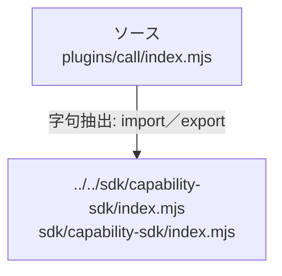

# dependency-map/group-1/n-plugins-call-index-mjs-a8d06d

[解析トップへ戻る](../../../README.md)

確認済みファイル: `plugins/call/index.mjs`

解析: 字句抽出。静的なimport／export参照です。関数の実行順序やHTTP通信は表していません。

宣言: `create`

- `../../sdk/capability-sdk/index.mjs` → `sdk/capability-sdk/index.mjs`（一覧確認・内容未読）

## 要素の説明

### n-sdk-capability-sdk-index-mjs-0d4e4a

参照名: `../../sdk/capability-sdk/index.mjs`

対応する実在ソース: `sdk/capability-sdk/index.mjs`。内容は未読。

### source

`plugins/call/index.mjs` の内容を確認しました。

