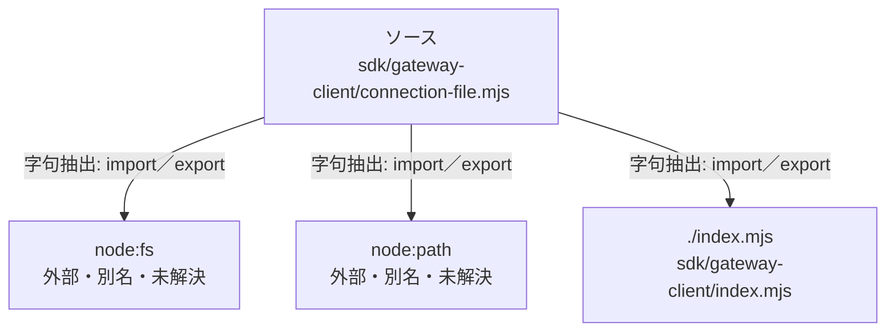

# dependency-map/group-1/n-sdk-gateway-client-connection-file-mjs-898eb1

[解析トップへ戻る](../../../README.md)

確認済みファイル: `sdk/gateway-client/connection-file.mjs`

解析: 字句抽出。静的なimport／export参照です。関数の実行順序やHTTP通信は表していません。

宣言: `readConnectionFile`

- `node:fs` → 外部・標準ライブラリ・別名など。ローカル対応先は未確定
- `node:path` → 外部・標準ライブラリ・別名など。ローカル対応先は未確定
- `./index.mjs` → `sdk/gateway-client/index.mjs`（一覧確認・内容未読）

## 要素の説明

### n-index-mjs-e0a830

参照名: `./index.mjs`

対応する実在ソース: `sdk/gateway-client/index.mjs`。内容は未読。

### n-node-fs-a15b7d

参照名: `node:fs`

ローカルのソース対応先を確定できませんでした。外部ライブラリ、標準ライブラリ、型別名などを区別する追加確認が必要です。

### n-node-path-78811c

参照名: `node:path`

ローカルのソース対応先を確定できませんでした。外部ライブラリ、標準ライブラリ、型別名などを区別する追加確認が必要です。

### source

`sdk/gateway-client/connection-file.mjs` の内容を確認しました。

