# dependency-map/group-2

[解析トップへ戻る](../../README.md)

このグループは表示用の区切りです。独立した実行モジュールではありません。

```mermaid
graph TD
    n-apps-gateway-lib-store-mjs-d299d2["store.mjs\napps/gateway/lib/store.mjs"]
    n-apps-gateway-lib-browser-session-mjs-0079b6["browser-session.mjs\napps/gateway/lib/browser-session.mjs"]
    n-apps-gateway-lib-alerts-mjs-8e463c["alerts.mjs\napps/gateway/lib/alerts.mjs"]
    n-apps-gateway-lib-schedules-mjs-0351f0["schedules.mjs\napps/gateway/lib/schedules.mjs"]
    n-apps-gateway-lib-batches-mjs-377107["batches.mjs\napps/gateway/lib/batches.mjs"]
    n-apps-gateway-lib-team-mjs-5b15a2["team.mjs\napps/gateway/lib/team.mjs"]
    n-apps-gateway-lib-public-accounts-mjs-a537fb["public-accounts.mjs\napps/gateway/lib/public-accounts.mjs"]
    n-apps-gateway-lib-purchases-mjs-841e54["purchases.mjs\napps/gateway/lib/purchases.mjs"]
```

## 要素の説明

### n-apps-gateway-lib-alerts-mjs-8e463c

確認済みファイル: `apps/gateway/lib/alerts.mjs`

解析: 字句抽出。静的なimport／export参照です。関数の実行順序やHTTP通信は表していません。

宣言: `alertConfiguration`, `alertSignature`, `Alerts`, `pinnedPost`

- `node:crypto` → 外部・標準ライブラリ・別名など。ローカル対応先は未確定
- `node:dns/promises` → 外部・標準ライブラリ・別名など。ローカル対応先は未確定
- `node:https` → 外部・標準ライブラリ・別名など。ローカル対応先は未確定
- `./security.mjs` → `apps/gateway/lib/security.mjs`（一覧確認・内容未読）

[詳細な図と説明を見る](n-apps-gateway-lib-alerts-mjs-8e463c/README.md)

### n-apps-gateway-lib-batches-mjs-377107

確認済みファイル: `apps/gateway/lib/batches.mjs`

解析: 字句抽出。静的なimport／export参照です。関数の実行順序やHTTP通信は表していません。

宣言: `Batches`

- `../../../packages/contract/dist/index.js` → 外部・標準ライブラリ・別名など。ローカル対応先は未確定
- `./phone-service.mjs` → `apps/gateway/lib/phone-service.mjs`（内容確認済み）
- `./service.mjs` → `apps/gateway/lib/service.mjs`（一覧確認・内容未読）
- `./security.mjs` → `apps/gateway/lib/security.mjs`（一覧確認・内容未読）

[詳細な図と説明を見る](n-apps-gateway-lib-batches-mjs-377107/README.md)

### n-apps-gateway-lib-browser-session-mjs-0079b6

確認済みファイル: `apps/gateway/lib/browser-session.mjs`

解析: 字句抽出。静的なimport／export参照です。関数の実行順序やHTTP通信は表していません。

宣言: `BrowserSessions`

- `./security.mjs` → `apps/gateway/lib/security.mjs`（一覧確認・内容未読）

[詳細な図と説明を見る](n-apps-gateway-lib-browser-session-mjs-0079b6/README.md)

### n-apps-gateway-lib-public-accounts-mjs-a537fb

確認済みファイル: `apps/gateway/lib/public-accounts.mjs`

解析: 字句抽出。静的なimport／export参照です。関数の実行順序やHTTP通信は表していません。

宣言: `publicHttps`, `settings`, `PublicAccounts`

- `node:crypto` → 外部・標準ライブラリ・別名など。ローカル対応先は未確定
- `node:net` → 外部・標準ライブラリ・別名など。ローカル対応先は未確定
- `./password-accounts.mjs` → `apps/gateway/lib/password-accounts.mjs`（一覧確認・内容未読）
- `./prerelease.mjs` → `apps/gateway/lib/prerelease.mjs`（一覧確認・内容未読）
- `./security.mjs` → `apps/gateway/lib/security.mjs`（一覧確認・内容未読）

[詳細な図と説明を見る](n-apps-gateway-lib-public-accounts-mjs-a537fb/README.md)

### n-apps-gateway-lib-purchases-mjs-841e54

確認済みファイル: `apps/gateway/lib/purchases.mjs`

解析: 字句抽出。静的なimport／export参照です。関数の実行順序やHTTP通信は表していません。

宣言: `httpsUrl`, `stripeSignatureValid`, `Purchases`

- `node:crypto` → 外部・標準ライブラリ・別名など。ローカル対応先は未確定
- `./security.mjs` → `apps/gateway/lib/security.mjs`（一覧確認・内容未読）

[詳細な図と説明を見る](n-apps-gateway-lib-purchases-mjs-841e54/README.md)

### n-apps-gateway-lib-schedules-mjs-0351f0

確認済みファイル: `apps/gateway/lib/schedules.mjs`

解析: 字句抽出。静的なimport／export参照です。関数の実行順序やHTTP通信は表していません。

宣言: `Schedules`

- `node:crypto` → 外部・標準ライブラリ・別名など。ローカル対応先は未確定
- `../../../packages/contract/dist/index.js` → 外部・標準ライブラリ・別名など。ローカル対応先は未確定
- `./phone-service.mjs` → `apps/gateway/lib/phone-service.mjs`（内容確認済み）
- `./service.mjs` → `apps/gateway/lib/service.mjs`（一覧確認・内容未読）
- `./security.mjs` → `apps/gateway/lib/security.mjs`（一覧確認・内容未読）

[詳細な図と説明を見る](n-apps-gateway-lib-schedules-mjs-0351f0/README.md)

### n-apps-gateway-lib-store-mjs-d299d2

確認済みファイル: `apps/gateway/lib/store.mjs`

解析: 字句抽出。静的なimport／export参照です。関数の実行順序やHTTP通信は表していません。

宣言: `Store`

- `node:sqlite` → 外部・標準ライブラリ・別名など。ローカル対応先は未確定
- `node:crypto` → 外部・標準ライブラリ・別名など。ローカル対応先は未確定
- `node:fs` → 外部・標準ライブラリ・別名など。ローカル対応先は未確定
- `node:path` → 外部・標準ライブラリ・別名など。ローカル対応先は未確定
- `./security.mjs` → `apps/gateway/lib/security.mjs`（一覧確認・内容未読）

[詳細な図と説明を見る](n-apps-gateway-lib-store-mjs-d299d2/README.md)

### n-apps-gateway-lib-team-mjs-5b15a2

確認済みファイル: `apps/gateway/lib/team.mjs`

解析: 字句抽出。静的なimport／export参照です。関数の実行順序やHTTP通信は表していません。

宣言: `outcomeOf`, `callRow`, `teamMissions`, `names`, `teamNotPlaced`, `teamUndeliveredAlerts`, `teamCalls`, `teamRecord`, `teamSummary`, `contactHistory`, `teamPeople`, `callsCsv`, `teamCallsCsv`, `ownCallsCsv`, `importContacts`

- `../../../packages/contract/dist/index.js` → 外部・標準ライブラリ・別名など。ローカル対応先は未確定
- `./phone-service.mjs` → `apps/gateway/lib/phone-service.mjs`（内容確認済み）
- `./security.mjs` → `apps/gateway/lib/security.mjs`（一覧確認・内容未読）

[詳細な図と説明を見る](n-apps-gateway-lib-team-mjs-5b15a2/README.md)

