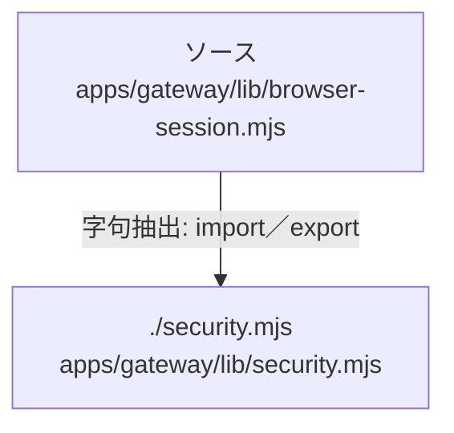

# dependency-map/group-2/n-apps-gateway-lib-browser-session-mjs-0079b6

[解析トップへ戻る](../../../README.md)

確認済みファイル: `apps/gateway/lib/browser-session.mjs`

解析: 字句抽出。静的なimport／export参照です。関数の実行順序やHTTP通信は表していません。

宣言: `BrowserSessions`

- `./security.mjs` → `apps/gateway/lib/security.mjs`（一覧確認・内容未読）

## 要素の説明

### n-security-mjs-7b9f61

参照名: `./security.mjs`

対応する実在ソース: `apps/gateway/lib/security.mjs`。内容は未読。

### source

`apps/gateway/lib/browser-session.mjs` の内容を確認しました。

