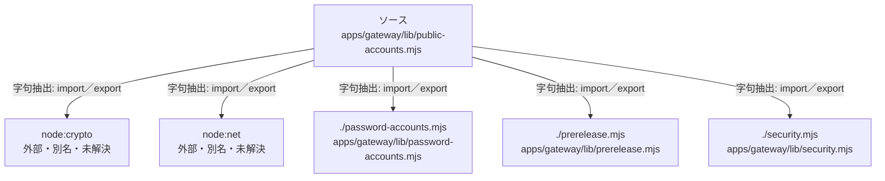

# dependency-map/group-2/n-apps-gateway-lib-public-accounts-mjs-a537fb

[解析トップへ戻る](../../../README.md)

確認済みファイル: `apps/gateway/lib/public-accounts.mjs`

解析: 字句抽出。静的なimport／export参照です。関数の実行順序やHTTP通信は表していません。

宣言: `publicHttps`, `settings`, `PublicAccounts`

- `node:crypto` → 外部・標準ライブラリ・別名など。ローカル対応先は未確定
- `node:net` → 外部・標準ライブラリ・別名など。ローカル対応先は未確定
- `./password-accounts.mjs` → `apps/gateway/lib/password-accounts.mjs`（一覧確認・内容未読）
- `./prerelease.mjs` → `apps/gateway/lib/prerelease.mjs`（一覧確認・内容未読）
- `./security.mjs` → `apps/gateway/lib/security.mjs`（一覧確認・内容未読）

## 要素の説明

### n-node-crypto-c7dfc5

参照名: `node:crypto`

ローカルのソース対応先を確定できませんでした。外部ライブラリ、標準ライブラリ、型別名などを区別する追加確認が必要です。

### n-node-net-1d0ad0

参照名: `node:net`

ローカルのソース対応先を確定できませんでした。外部ライブラリ、標準ライブラリ、型別名などを区別する追加確認が必要です。

### n-password-accounts-mjs-017c70

参照名: `./password-accounts.mjs`

対応する実在ソース: `apps/gateway/lib/password-accounts.mjs`。内容は未読。

### n-prerelease-mjs-d3db3a

参照名: `./prerelease.mjs`

対応する実在ソース: `apps/gateway/lib/prerelease.mjs`。内容は未読。

### n-security-mjs-7b9f61

参照名: `./security.mjs`

対応する実在ソース: `apps/gateway/lib/security.mjs`。内容は未読。

### source

`apps/gateway/lib/public-accounts.mjs` の内容を確認しました。

