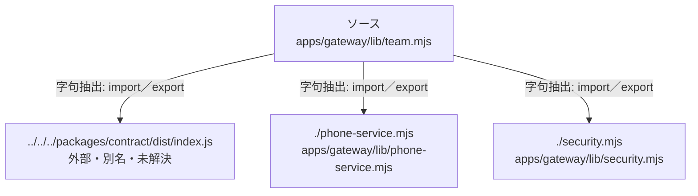

# dependency-map/group-2/n-apps-gateway-lib-team-mjs-5b15a2

[解析トップへ戻る](../../../README.md)

確認済みファイル: `apps/gateway/lib/team.mjs`

解析: 字句抽出。静的なimport／export参照です。関数の実行順序やHTTP通信は表していません。

宣言: `outcomeOf`, `callRow`, `teamMissions`, `names`, `teamNotPlaced`, `teamUndeliveredAlerts`, `teamCalls`, `teamRecord`, `teamSummary`, `contactHistory`, `teamPeople`, `callsCsv`, `teamCallsCsv`, `ownCallsCsv`, `importContacts`

- `../../../packages/contract/dist/index.js` → 外部・標準ライブラリ・別名など。ローカル対応先は未確定
- `./phone-service.mjs` → `apps/gateway/lib/phone-service.mjs`（内容確認済み）
- `./security.mjs` → `apps/gateway/lib/security.mjs`（一覧確認・内容未読）

## 要素の説明

### n-packages-contract-dist-index-js-6a2376

参照名: `../../../packages/contract/dist/index.js`

ローカルのソース対応先を確定できませんでした。外部ライブラリ、標準ライブラリ、型別名などを区別する追加確認が必要です。

### n-phone-service-mjs-707f58

参照名: `./phone-service.mjs`

対応する実在ソース: `apps/gateway/lib/phone-service.mjs`。内容確認済み。

### n-security-mjs-7b9f61

参照名: `./security.mjs`

対応する実在ソース: `apps/gateway/lib/security.mjs`。内容は未読。

### source

`apps/gateway/lib/team.mjs` の内容を確認しました。

