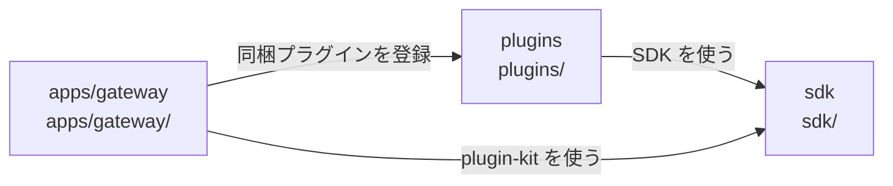

# dependency-map/outside-workspace

[解析トップへ戻る](../README.md) ・ [ひとつ上へ](../README.md)

pnpm workspace の外にあり、相対パスの import で検査される。

## 要素

### gateway-dep

sdk、plugins、ビルド済みの packages / providers（dist）だけを import できる。src の直接参照は禁止。

[説明を見る](gateway-dep/README.md)

### plugins-dep

sdk と plugins 自身だけを import できる。Gateway や runtime には届かない。

[説明を見る](plugins-dep/README.md)

### sdk-dep

何にも依存しない。

[説明を見る](sdk-dep/README.md)
