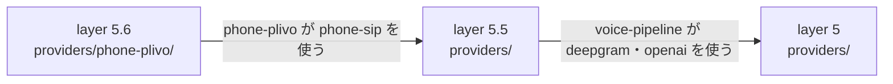

# dependency-map/provider-packages

[解析トップへ戻る](../README.md) ・ [ひとつ上へ](../README.md)

layer 5 は単体の実装、5.5 はそれらを組み合わせる実装、5.6 は 5.5 を再利用する実装。同じ層どうしは import できない。

## 要素

### layer5

simulator、gemini-live、deepgram、openai-realtime、openai、gemini、elevenlabs、ollama。elevenlabs は @oathra に依存しない。

[説明を見る](layer5/README.md)

### layer55

voice-pipeline（deepgram と openai に依存）、phone-twilio、phone-sip、gateway-livekit（いずれも phone に依存）。

[説明を見る](layer55/README.md)

### layer56

phone-plivo（phone-sip に依存）。

[説明を見る](layer56/README.md)
