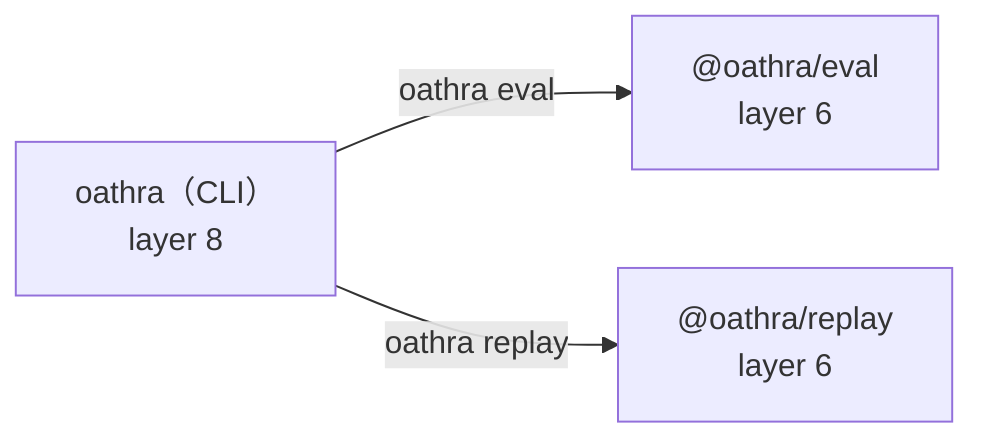

# dependency-map/top

[解析トップへ戻る](../README.md) ・ [ひとつ上へ](../README.md)

replay と eval（6）、CLI（8）。

## 要素

### cli-pkg

依存先: 上記すべてと providers

[説明を見る](cli-pkg/README.md)

### eval

依存先: runtime、scenario、core、contract、evidence、simulator

[説明を見る](eval/README.md)

### replay

依存先: runtime、core、contract、evidence

[説明を見る](replay/README.md)
