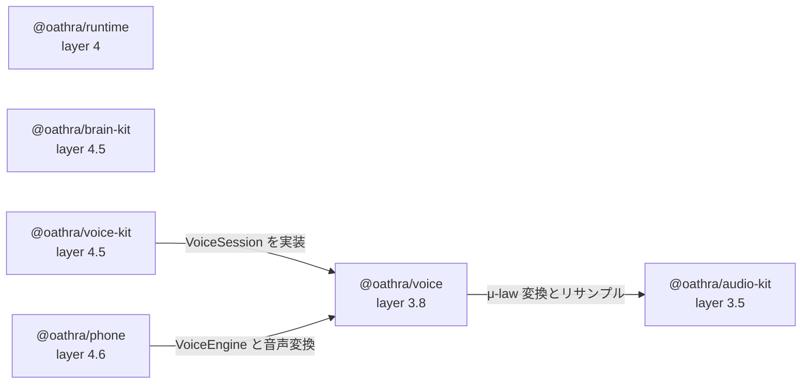

# dependency-map/voice-phone-runtime

[解析トップへ戻る](../README.md) ・ [ひとつ上へ](../README.md)

audio-kit（3.5）→ voice（3.8）→ runtime（4）→ brain-kit・voice-kit（4.5）→ phone（4.6）。

## 要素

### audio-kit

依存先: core

[説明を見る](audio-kit/README.md)

### brain-kit

依存先: contract、core、evidence

[説明を見る](brain-kit/README.md)

### phone

依存先: voice、core、contract、evidence

[説明を見る](phone/README.md)

### runtime

依存先: contract、core、evidence

[説明を見る](runtime/README.md)

### voice

依存先: audio-kit、contract、core、evidence

[説明を見る](voice/README.md)

### voice-kit

依存先: contract、core、evidence、voice

[説明を見る](voice-kit/README.md)
