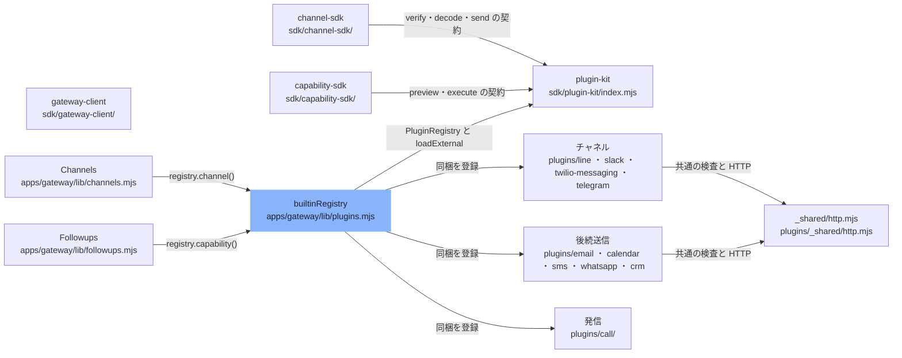

# extension-points

[解析トップへ戻る](../README.md)

# プラグインの仕組み

sdk/plugin-kit が manifest を検証して PluginRegistry に登録し、Gateway の Channels（受信）と Followups（後続送信）が registry 経由でプラグインを呼ぶ。プラグインはサンドボックスではなく、同じプロセスで動く信頼済みのコード。

## 制約

- id は英小文字とハイフン、apiVersion は 1 固定。kind は channel か capability。
- channel は channel:send が必須。approval:request を持つなら mission:read も必須。
- capability の effect は email / calendar / sms / crm / call のどれか。新しい effect の追加は本体側のレビューが必要。
- OATHRA_DATA_KEY などの秘密は environment に宣言できない。
- 外部プラグインは明示したパスだけを読み、sha256 の整合性が合わなければ拒否する。

## 要素

### call-plugin

effect=call。Gateway の phone.mjs の executeCall に委ねる。識別子には phone.mjs と音声エンジンの設定も含まれる。

[説明を見る](call-plugin/README.md)

### capability-plugins

email（Gmail）、calendar（Google Calendar）、sms（Twilio）、whatsapp（Twilio、effect は sms）、crm（HubSpot）。

[説明を見る](capability-plugins/README.md)

### capability-sdk

defineCapability（preview と execute が必須）と defineCallCapability（execute だけ）。

[説明を見る](capability-sdk/README.md)

### channel-plugins

line（承認ボタンと音声の文字起こし）、slack、twilio-messaging（SMS・WhatsApp の受信。承認ボタンは持たず、下書きまで）。telegram は同梱されず、外部プラグインとして読み込む例。

[説明を見る](channel-plugins/README.md)

### channel-sdk

defineChannel。verify / decode / send を必須にする。チャネルはプロトコルの変換だけを担い、依頼の作成や承認の発行はしない。

[説明を見る](channel-sdk/README.md)

### channels-host

verify → decode → イベント検証 → inbox → 下書き → outbox → send。本人紐付けと方針はホスト側が持つ。

[説明を見る](channels-host/README.md)

### followups-host

capability を followup:execute 権限で呼ぶ。effect（email / sms / calendar / crm）ごとに宛先と必要な証拠を決める。

[説明を見る](followups-host/README.md)

### gateway-client

実験的な Gateway v1 クライアント。下書き・確認・承認・取消を呼ぶ。HTTPS（または loopback）だけを許し、変更系は自動で再試行しない。

[説明を見る](gateway-client/README.md)

### plugin-kit

validateManifest、設定スキーマの検証、ディレクトリの整合性ハッシュ、PluginRegistry、loadExternal。権限（grants）・識別子（identity）・有効/無効を管理する。

[説明を見る](plugin-kit/README.md)

### registry-loader

同梱9件を登録し、各プラグインには manifest で宣言した環境変数だけを渡す。OATHRA_PLUGINS_FILE で同梱の無効化と外部プラグインの読み込みを行う。

[説明を見る](registry-loader/README.md)

### shared-http

プラグイン共通の検査、定数時間比較、HMAC、リダイレクト禁止とタイムアウトつきの fetch。

[説明を見る](shared-http/README.md)
