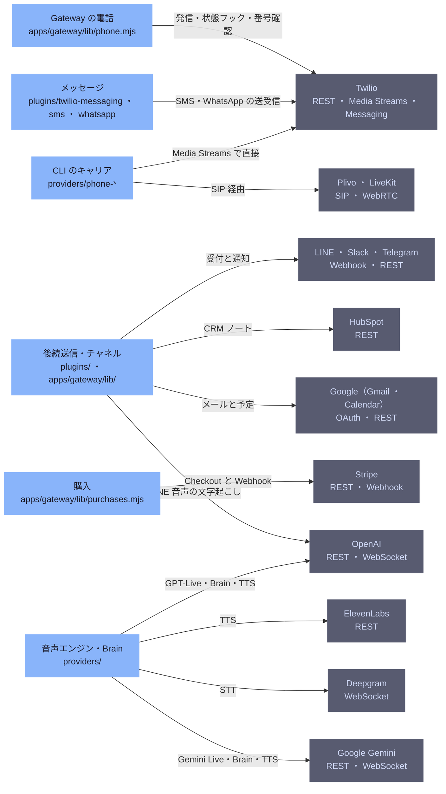

# external-integrations

[解析トップへ戻る](../README.md)

# 外部サービスとの接続

Oathra のどの部分が、どの外部サービスに、何のためにつながるか。左が Oathra 側、右が外部サービス。

## 制約

外部への書き込み（メール・SMS・WhatsApp・予定・CRM）は、通話とは別のプレビューと承認を経る。結果が分からない送信は自動で再送しない。

## 注意点

Gateway の電話は providers/phone-twilio を使わず、Twilio を直接呼ぶ。CLI の経路（providers）とは別実装。

## 要素

### chat

依頼の受付と結果の通知。

[説明を見る](chat/README.md)

### cli-carriers

oathra phone の発信経路。Twilio は直接、Plivo と SIP は SipGateway 経由。

[説明を見る](cli-carriers/README.md)

### deepgram

pipeline のストリーミング音声認識。

[説明を見る](deepgram/README.md)

### elevenlabs

pipeline の TTS（ulaw_8000）。

[説明を見る](elevenlabs/README.md)

### engines

GPT-Live、Gemini Live、pipeline（STT・Brain・TTS）。

[説明を見る](engines/README.md)

### gemini

Gemini Live、Brain、TTS。

[説明を見る](gemini/README.md)

### google

後続送信のメールと予定作成。

[説明を見る](google/README.md)

### gw-billing

Stripe Checkout の作成と、署名つき Webhook の処理。

[説明を見る](gw-billing/README.md)

### gw-business

メール、予定、CRM、LINE、Slack、Telegram。

[説明を見る](gw-business/README.md)

### gw-messaging

SMS と WhatsApp の受信（下書きまで）と、通話後の結果送信。

[説明を見る](gw-messaging/README.md)

### gw-phone

Twilio の Calls API で発信し、/hooks/twilio/* で状態と同意を受ける。Twilio Verify で利用者の番号を確認する。

[説明を見る](gw-phone/README.md)

### hubspot

CRM のノート作成。

[説明を見る](hubspot/README.md)

### openai

GPT-Live の音声対話、Chat の Brain、TTS、LINE 音声の文字起こし。

[説明を見る](openai/README.md)

### plivo-livekit

Plivo Zentrunk の SIP トランクと、LiveKit の SIP ゲートウェイ・ルーム。

[説明を見る](plivo-livekit/README.md)

### stripe

クレジット購入の Checkout と支払い通知。

[説明を見る](stripe/README.md)

### twilio

発信、Media Streams（WebSocket）、Verify、番号の検索・購入、SMS・WhatsApp の送受信。日本の番号は SMS 非対応（2026-10-11 時点）。

[説明を見る](twilio/README.md)
