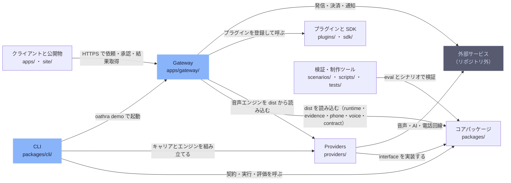

# overall-architecture

[解析トップへ戻る](../README.md)

# Oathra の全体構成

AI エージェントが電話で現実の用事を済ませ、その達成を決定論的な証拠で示すためのモノレポ。TypeScript のコアパッケージ（pnpm workspace）、その実装である providers、素の ESM で書かれた Gateway・プラグイン・SDK、利用者向けのクライアントと公開サイトに分かれる。

この図はコードを読んで作った構成図で、実行して確かめた通信経路ではない。

## 背景

製品の目的は docs/GOAL.md、設計は docs/ARCHITECTURE.md。完了は必ず packages/evidence の evaluate() で決め、モデルの意見では決めない。

## 制約

依存方向は scripts/check-deps.mjs が強制する（pnpm lint:deps）。キャリア（phone-*）と音声エンジンは互いに import しない。

## 注意点

Gateway の Twilio 発信は providers/phone-twilio を通らず、apps/gateway/lib/phone.mjs が自前で行う。CLI と Gateway で電話の経路が二系統ある。

## 要素

### cli

oathra コマンド。シミュレーション、評価、電話の試験、リプレイ、MCP。packages と providers を組み立てて使う。

[説明を見る](cli/README.md)

### clients

Gateway を操作するアプリと、公開サイト。

[詳細な図と説明を見る](clients/README.md)

### core-packages

pnpm workspace の TypeScript パッケージ。通話契約（contract）、決定論的な完了判定（evidence）、共通 interface（core）、通話ループ（runtime）、電話と音声の層（phone / voice）、評価（eval / replay）、CLI（cli）。依存は下位の層だけに向く。

[詳細な図と説明を見る](core-packages/README.md)

### external-services

Oathra が接続する外部サービス。詳しくは external-integrations を参照。

[詳細な図と説明を見る](external-services/README.md)

### gateway

pnpm workspace の外にある素の ESM サーバー。依頼の受付・承認・実行・判定・課金・通知を一つのプロセスで行う。packages と providers はビルド済みの dist だけを読み込む。

[詳細な図と説明を見る](gateway/README.md)

### plugins-sdk

Gateway の外にある素の ESM。sdk は何にも依存せず、plugins は sdk だけを import する。詳しくは extension-points を参照。

[詳細な図と説明を見る](plugins-sdk/README.md)

### providers

Phone Layer と Voice Layer の具体的な実装。キャリア（phone-*）と音声エンジン（openai-realtime、gemini-live、voice-pipeline）は互いに import しない。共有するものは voice-kit・audio-kit・brain-kit に置く。

[詳細な図と説明を見る](providers/README.md)

### tooling

シナリオ、検証スクリプト、UI の画面検査、動画制作。

[詳細な図と説明を見る](tooling/README.md)
