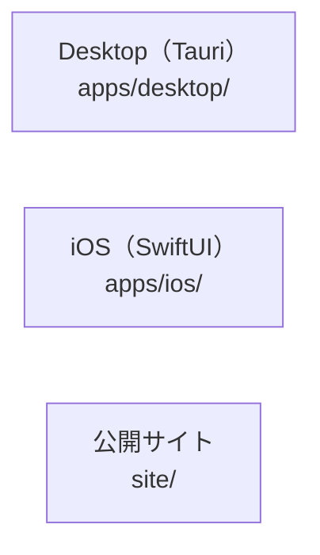

# overall-architecture/clients

[解析トップへ戻る](../README.md) ・ [ひとつ上へ](../README.md)

Gateway を操作するアプリと、公開サイト。

## 要素

### desktop

Rust と WKWebView の軽いデスクトップシェル。指定した Oathra サーバーの画面をそのまま表示する。

[説明を見る](desktop/README.md)

### ios

SwiftUI のネイティブアプリ（xcodegen で生成）。HTTPS の Gateway URL とトークンで依頼・確認・進行・証拠を扱う。

[説明を見る](ios/README.md)

### site

日本語と英語の静的サイト。site/src の TypeScript を scripts/build-site.mjs（esbuild）でまとめる。site/demos は合成データの模擬デモで、本番と同じ defineCall と evaluate() で判定する。

[説明を見る](site/README.md)
