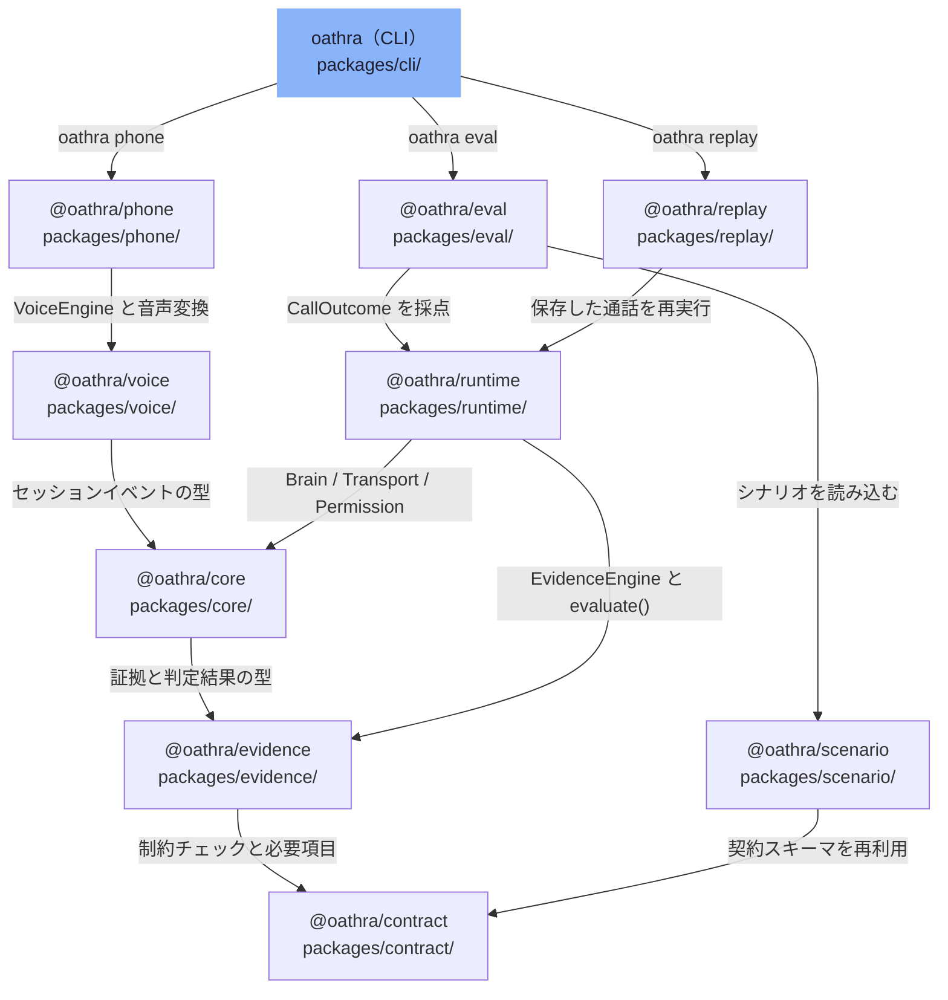

# overall-architecture/core-packages

[解析トップへ戻る](../README.md) ・ [ひとつ上へ](../README.md)

pnpm workspace の TypeScript パッケージ。通話契約（contract）、決定論的な完了判定（evidence）、共通 interface（core）、通話ループ（runtime）、電話と音声の層（phone / voice）、評価（eval / replay）、CLI（cli）。依存は下位の層だけに向く。

## 要素

### cli

最上位の CLI。bin.ts → commands.ts（call / eval / phone / replay / demo など）、phone.ts（キャリア登録とエンジン構築、phone test）、brains.ts（Brain の選択）、mcp.ts（MCP stdio サーバー）。

[詳細な図と説明を見る](cli/README.md)

### contract

通話契約 CallContract の zod スキーマと defineCall、制約・権限・予算・Intake の検証、電話依頼 PhoneRequest（phone-input.ts）、電話テンプレート、連絡先スキーマ。最下層で、他の @oathra に依存しない。

[説明を見る](contract/README.md)

### core

Transport / Brain / STT / TTS / Permission などのプロバイダ interface（providers.ts）、状態機械（state.ts）、イベントログ（events.ts）、録音・記録の告知と日本語の読み上げ正規化（speech.ts）、予約台帳などのドメイン処理。

[説明を見る](core/README.md)

### eval

評価ハーネス。シナリオ実行と採点、simulator の truth() と照合する False Completion の検出、敵対的テスト（adversarial.ts）。

[説明を見る](eval/README.md)

### evidence

LLM を使わない決定論的な完了判定。normalize.ts が日時・価格・電話番号・数量・シリアルを解析し、extract.ts が発話から主張を抜き出し、EvidenceEngine（engine.ts）が証拠グラフを作り、evaluate()（evaluate.ts）が完了を判定する。proof.ts は実世界の行動に対する証明の段階を定義する。

[詳細な図と説明を見る](evidence/README.md)

### phone

Phone Layer。bridge.ts の PhoneTransport / BridgedCallSession がキャリアと音声エンジンの音声を変換して中継する。CarrierTransport / SipGateway / PhoneProvider の interface（types.ts）、PhoneRegistry と PhoneRouter、診断と料金見積もり。

[詳細な図と説明を見る](phone/README.md)

### replay

通話の保存・読み込み・再生、タイムラインと要約の描画。

[説明を見る](replay/README.md)

### runtime

通話ループの本体。CallRuntime と runCall() が Brain・Transport・EvidenceEngine を回し、権限と制約を確認して CallOutcome を返す。完了の判定は evidence の evaluate() に任せる。

[説明を見る](runtime/README.md)

### scenario

シナリオの zod スキーマ、ファイル・ディレクトリの読み込み、シナリオから CallContract への変換。

[説明を見る](scenario/README.md)

### voice

Voice Layer の共通部品。AudioSpec（MULAW_8K、PCM_16K など）、convert() による形式変換、VoiceEngine / VoiceSession の interface、OutputQueue。

[説明を見る](voice/README.md)
