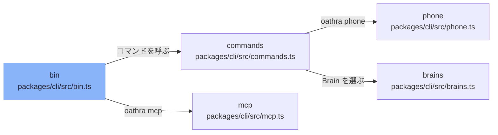

# overall-architecture/core-packages/cli

[解析トップへ戻る](../../README.md) ・ [ひとつ上へ](../README.md)

最上位の CLI。bin.ts → commands.ts（call / eval / phone / replay / demo など）、phone.ts（キャリア登録とエンジン構築、phone test）、brains.ts（Brain の選択）、mcp.ts（MCP stdio サーバー）。

## 要素

### bin

入口。.env を読み、引数を解析してコマンドに振り分ける。

[説明を見る](bin/README.md)

### brains

Brain プロバイダの一覧と選択。

[説明を見る](brains/README.md)

### commands

call / eval / battle / replay / scenario / doctor などの実装。

[説明を見る](commands/README.md)

### mcp

MCP の stdio サーバー。

[説明を見る](mcp/README.md)

### phone-cmd

phone サブコマンド。buildRegistry() でキャリアを、buildEngine() で音声エンジンを組み立てる（--engine、--tts）。

[説明を見る](phone-cmd/README.md)
