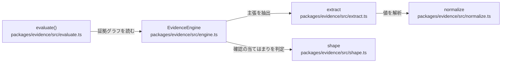

# overall-architecture/core-packages/evidence

[解析トップへ戻る](../../README.md) ・ [ひとつ上へ](../README.md)

LLM を使わない決定論的な完了判定。normalize.ts が日時・価格・電話番号・数量・シリアルを解析し、extract.ts が発話から主張を抜き出し、EvidenceEngine（engine.ts）が証拠グラフを作り、evaluate()（evaluate.ts）が完了を判定する。proof.ts は実世界の行動に対する証明の段階を定義する。

## 要素

### engine

発話を受け取り、証拠グラフを組み立てる。確認の方式（callee_acceptance など）を扱う。

[説明を見る](engine/README.md)

### evaluate

EvidenceEngine の状態から VerifiedResult を作る。完了の判定はここだけが行う。

[説明を見る](evaluate/README.md)

### extract

発話から主張（claim）を抜き出し、承諾・合意・確認の依頼を見分ける。

[説明を見る](extract/README.md)

### normalize

日時・時刻・価格・電話番号・人数・数量・シリアルを決定論的に解析する。

[説明を見る](normalize/README.md)

### shape

相手の発話の形と、確認が要求に合っているかを判定する。

[説明を見る](shape/README.md)
