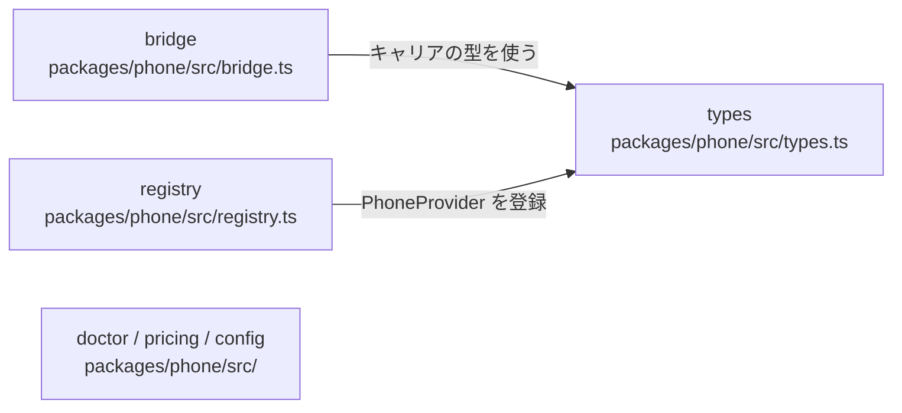

# overall-architecture/core-packages/phone

[解析トップへ戻る](../../README.md) ・ [ひとつ上へ](../README.md)

Phone Layer。bridge.ts の PhoneTransport / BridgedCallSession がキャリアと音声エンジンの音声を変換して中継する。CarrierTransport / SipGateway / PhoneProvider の interface（types.ts）、PhoneRegistry と PhoneRouter、診断と料金見積もり。

## 要素

### bridge

PhoneTransport と BridgedCallSession。キャリアの音声（μ-law 8k が基本）とエンジンの音声を変換して中継し、通話の冒頭で告知を流す。

[説明を見る](bridge/README.md)

### doctor-pricing

電話環境の診断、料金の見積もり、設定ファイル。

[説明を見る](doctor-pricing/README.md)

### registry

PhoneRegistry と PhoneRouter。設定の優先順にキャリアを選び、つながらなければ次を試す。

[説明を見る](registry/README.md)

### types

CarrierTransport / CarrierMediaSession / SipGateway / PhoneProvider の interface。

[説明を見る](types/README.md)
