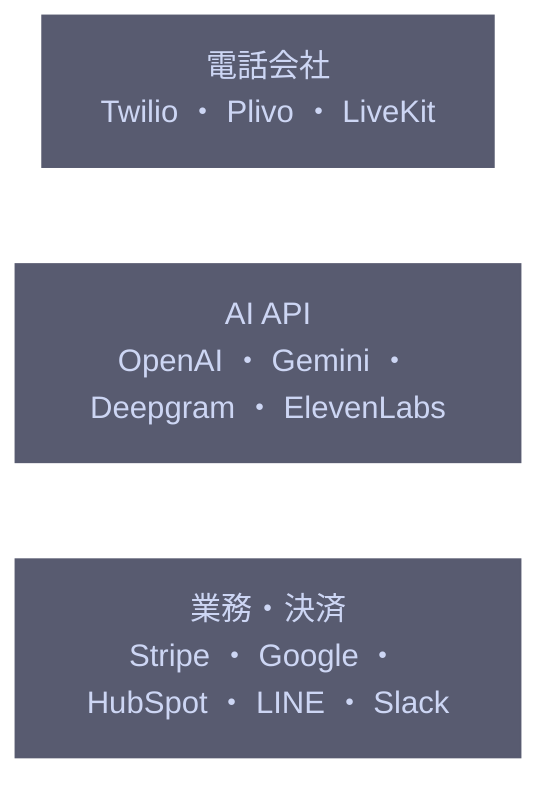

# overall-architecture/external-services

[解析トップへ戻る](../README.md) ・ [ひとつ上へ](../README.md)

Oathra が接続する外部サービス。詳しくは external-integrations を参照。

## 要素

### ai-apis

音声エンジン、STT、TTS、Brain。

[説明を見る](ai-apis/README.md)

### business-apis

購入、メール、予定、CRM、チャット。

[説明を見る](business-apis/README.md)

### telephony

発信・着信・SMS・WhatsApp。

[説明を見る](telephony/README.md)
