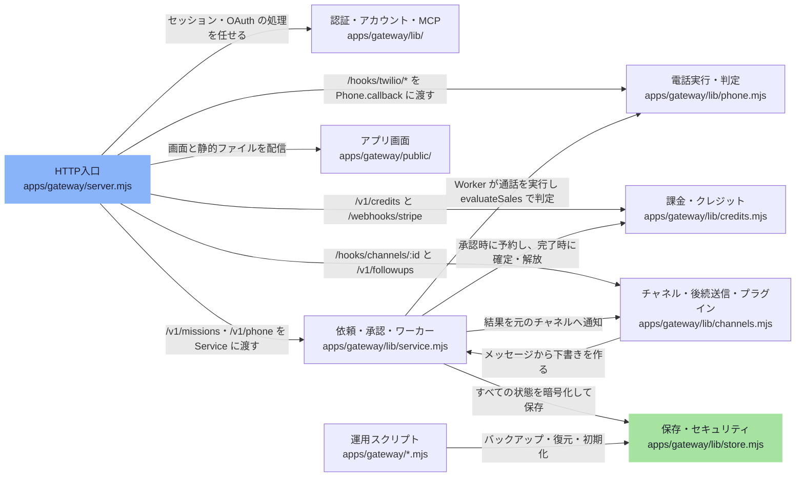

# overall-architecture/gateway

[解析トップへ戻る](../README.md) ・ [ひとつ上へ](../README.md)

pnpm workspace の外にある素の ESM サーバー。依頼の受付・承認・実行・判定・課金・通知を一つのプロセスで行う。packages と providers はビルド済みの dist だけを読み込む。

## 背景

oathra demo（練習モード）とサービス版（managed）の両方がこのサーバーを使う。デプロイは apps/gateway/deploy の compose 構成。

## 制約

packages / providers の src を直接 import してはいけない（dist のみ）。sdk と plugins 以外の上位を import しない（scripts/check-deps.mjs）。

## 要素

### auth-accounts

Bearer トークン（Service の利用者表）、ブラウザセッション、パスワードとメールリンク、公開サインアップ、MCP 向け OAuth と営業 MCP の JSON-RPC、チーム内の通話一覧を扱う。

[詳細な図と説明を見る](auth-accounts/README.md)

### billing-credits

整数クレジットの台帳、ナノドル単位の料金計算、Stripe Checkout と Webhook による購入。

[詳細な図と説明を見る](billing-credits/README.md)

### channels-plugins

Channels が /hooks/channels/:id の受信を共通化する（署名検証 → 変換 → 本人紐付け → 下書き）。Followups は通話後のメール・SMS・WhatsApp・予定・CRM への書き込みを、別のプレビューと承認で実行する。各プロトコルの処理はプラグインが持つ。

[詳細な図と説明を見る](channels-plugins/README.md)

### gateway-ui

素の HTML/JS の画面。public/phone/base は旧 Arena 由来のマークアップで、phone-ui.mjs がずれを検査して配信する。

[詳細な図と説明を見る](gateway-ui/README.md)

### http-entry

configuration(env) で設定を検証し、createGateway() が Store・Service・Worker・Phone・Channels・Followups・プラグイン登録を組み立てる。node:http で /v1/*、/hooks/twilio/*、/hooks/channels/:id、/webhooks/stripe、/mcp、/oauth/* を処理し、/healthz と /readyz を返す。SIGTERM では進行中の通話を待ってから終了する。

[詳細な図と説明を見る](http-entry/README.md)

### mission-worker

Service が依頼（mission）の下書き・確認・承認・取消と方針チェック（営業時間、停止リスト、同意）を行い、Worker が QUEUED の依頼を順に実行して結果を確定する。定期通話と一括通話も同じ承認経路に流す。

[詳細な図と説明を見る](mission-worker/README.md)

### ops-scripts

初期設定、番号の購入と Webhook 設定、バックアップと復元、stdio の MCP、デプロイ定義。変更を伴うものは既定で表示だけ行い、--apply や --yes で実行する。

[詳細な図と説明を見る](ops-scripts/README.md)

### phone-execution

Phone が Twilio への発信と着信フック（/hooks/twilio/*）を自前で処理し、packages/runtime・phone・voice と providers の音声エンジン（GPT-Live、Gemini Live、pipeline）を dist から読み込んで通話する。通話の結果は sales.mjs が packages/evidence の EvidenceEngine と evaluate() で判定する。

[詳細な図と説明を見る](phone-execution/README.md)

### storage-security

単一ノードの SQLite（node:sqlite）に AES-256-GCM で暗号化して保存する。security.mjs は assert / Fault / hash / 入力検証などの共通部品。

[詳細な図と説明を見る](storage-security/README.md)
