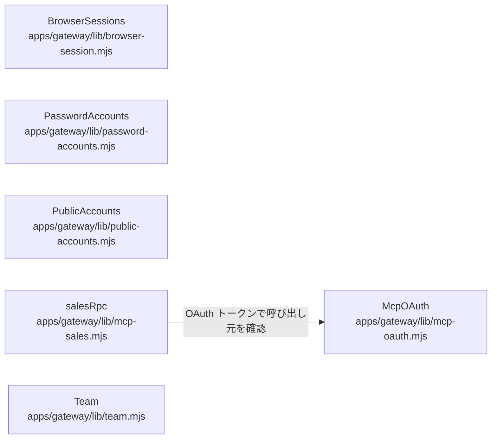

# overall-architecture/gateway/auth-accounts

[解析トップへ戻る](../../README.md) ・ [ひとつ上へ](../README.md)

Bearer トークン（Service の利用者表）、ブラウザセッション、パスワードとメールリンク、公開サインアップ、MCP 向け OAuth と営業 MCP の JSON-RPC、チーム内の通話一覧を扱う。

## 要素

### browser-session

不透明なブラウザ資格情報。有効期間は8時間で固定。

[説明を見る](browser-session/README.md)

### mcp-oauth

MCP クライアント向けの OAuth（メタデータ、登録、トークン、失効、承認画面）。

[説明を見る](mcp-oauth/README.md)

### mcp-sales

POST /mcp の JSON-RPC。営業依頼の下書きを作るツールを公開する。

[説明を見る](mcp-sales/README.md)

### password-accounts

パスワード設定リンクとパスワード認証。

[説明を見る](password-accounts/README.md)

### public-accounts

メール所有確認つきの公開アカウント作成。

[説明を見る](public-accounts/README.md)

### team

同じチームの通話一覧・要約・CSV 出力・連絡先取り込み。

[説明を見る](team/README.md)
