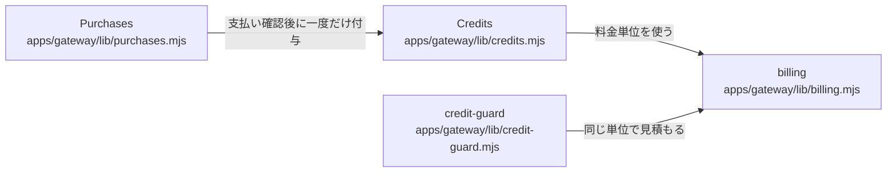

# overall-architecture/gateway/billing-credits

[解析トップへ戻る](../../README.md) ・ [ひとつ上へ](../README.md)

整数クレジットの台帳、ナノドル単位の料金計算、Stripe Checkout と Webhook による購入。

## 要素

### billing

billingConfiguration と METERED（従量）方式、ナノドル単位の計算。

[説明を見る](billing/README.md)

### credit-guard

決済と同じ単位の見積もり（台帳は変えない）。

[説明を見る](credit-guard/README.md)

### credits

予約・確定・解放・付与。

[説明を見る](credits/README.md)

### purchases

クレジットパック、Checkout の作成、/webhooks/stripe の処理。

[説明を見る](purchases/README.md)
