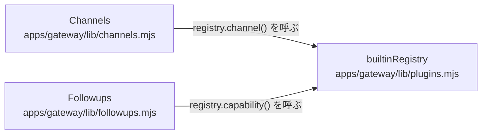

# overall-architecture/gateway/channels-plugins

[解析トップへ戻る](../../README.md) ・ [ひとつ上へ](../README.md)

Channels が /hooks/channels/:id の受信を共通化する（署名検証 → 変換 → 本人紐付け → 下書き）。Followups は通話後のメール・SMS・WhatsApp・予定・CRM への書き込みを、別のプレビューと承認で実行する。各プロトコルの処理はプラグインが持つ。

## 要素

### channels

receive() → inbox → process() → outbox → send()。未連携の送信者からは連携コードだけを受け付ける。

[説明を見る](channels/README.md)

### followups

preview() で内容を固定し、承認後に execute() する。結果が分からない送信は UNKNOWN にして自動で再送しない。

[説明を見る](followups/README.md)

### plugin-loader

同梱の9プラグインを登録し、OATHRA_PLUGINS_FILE があれば外部プラグインも読み込む。

[説明を見る](plugin-loader/README.md)
