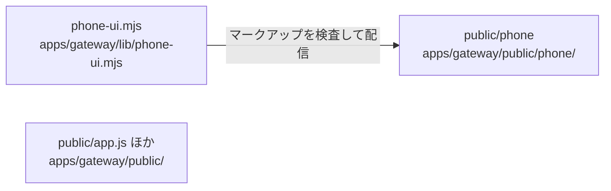

# overall-architecture/gateway/gateway-ui

[解析トップへ戻る](../../README.md) ・ [ひとつ上へ](../README.md)

素の HTML/JS の画面。public/phone/base は旧 Arena 由来のマークアップで、phone-ui.mjs がずれを検査して配信する。

## 要素

### app-pages

練習モードと管理画面、エージェント接続画面。

[説明を見る](app-pages/README.md)

### phone-pages

電話アプリの画面（連絡先、予約、アカウント、領収書など）。

[説明を見る](phone-pages/README.md)

### phone-ui

phonePage()。public/phone/base の欠落やずれを検出する。

[説明を見る](phone-ui/README.md)
