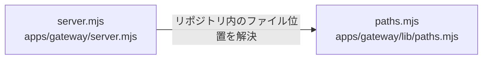

# overall-architecture/gateway/http-entry

[解析トップへ戻る](../../README.md) ・ [ひとつ上へ](../README.md)

configuration(env) で設定を検証し、createGateway() が Store・Service・Worker・Phone・Channels・Followups・プラグイン登録を組み立てる。node:http で /v1/*、/hooks/twilio/*、/hooks/channels/:id、/webhooks/stripe、/mcp、/oauth/* を処理し、/healthz と /readyz を返す。SIGTERM では進行中の通話を待ってから終了する。

## 要素

### paths

repoUrl()。npm 同梱時は OATHRA_GATEWAY_ROOT を基準にファイルを解決する。

[説明を見る](paths/README.md)

### server

configuration() と createGateway()。全ルートの定義、レート制限の区分（hook など）、静的ファイル配信、終了処理。

[説明を見る](server/README.md)
