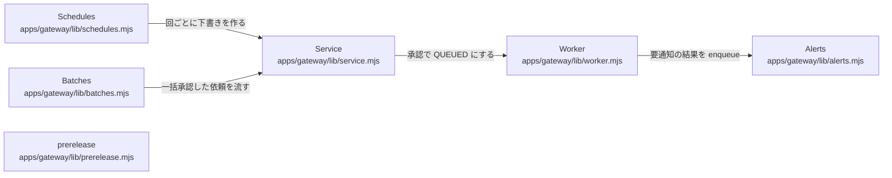

# overall-architecture/gateway/mission-worker

[解析トップへ戻る](../../README.md) ・ [ひとつ上へ](../README.md)

Service が依頼（mission）の下書き・確認・承認・取消と方針チェック（営業時間、停止リスト、同意）を行い、Worker が QUEUED の依頼を順に実行して結果を確定する。定期通話と一括通話も同じ承認経路に流す。

## 要素

### alerts

職員向けの通知（緊急の発話、不達など）。

[説明を見る](alerts/README.md)

### batches

リストの一括承認と順次実行。

[説明を見る](batches/README.md)

### prerelease

リリース前の制限を、すべての発信入口に適用する。

[説明を見る](prerelease/README.md)

### schedules

承認済みの定期通話を、回ごとに下書きとして作る。

[説明を見る](schedules/README.md)

### service

prepare / phoneRequest / review / start / cancel、承認トークン（grant）、連絡先・商品・同意の保存。

[説明を見る](service/README.md)

### worker

tick() が約5秒ごとに claimNext() で依頼を取り、run() で通話する。inbox / outbox / alert のキューも処理する。途中で止まった通話は UNKNOWN にして自動で再発信しない。

[説明を見る](worker/README.md)
