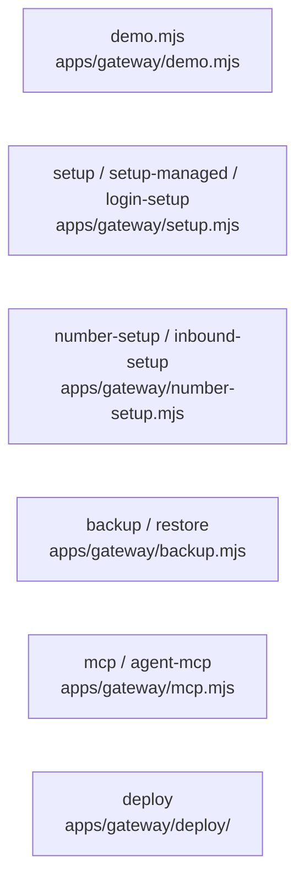

# overall-architecture/gateway/ops-scripts

[解析トップへ戻る](../../README.md) ・ [ひとつ上へ](../README.md)

初期設定、番号の購入と Webhook 設定、バックアップと復元、stdio の MCP、デプロイ定義。変更を伴うものは既定で表示だけ行い、--apply や --yes で実行する。

## 要素

### backup-restore

SQLite のオンラインバックアップと復元（既存は上書きしない）。

[説明を見る](backup-restore/README.md)

### demo

oathra demo の実体。練習モードで起動し、このパソコンからはログインなしで開ける。

[説明を見る](demo/README.md)

### deploy

Dockerfile、compose.yml（read_only、cap_drop ALL、停止猶予 360 秒）、Caddyfile（TLS のリバースプロキシ）。

[説明を見る](deploy/README.md)

### mcp-scripts

mcp は読み取りと下書きだけの stdio MCP。agent-mcp は sdk/gateway-client 経由の限定的な電話ツール。承認ツールは出さない。

[説明を見る](mcp-scripts/README.md)

### number-inbound

Twilio 番号の検索・購入と、着信・SMS の Webhook 設定。

[説明を見る](number-inbound/README.md)

### setup

自己ホストの初期化、managed 用の空の作業領域、期限つきログインリンク。

[説明を見る](setup/README.md)
