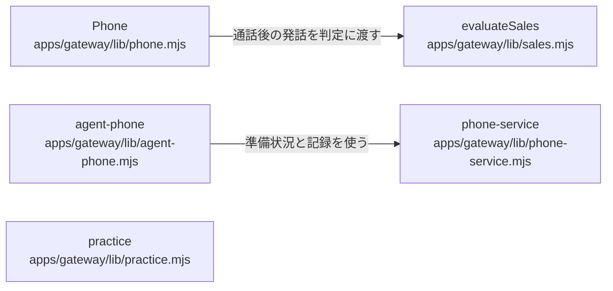

# overall-architecture/gateway/phone-execution

[解析トップへ戻る](../../README.md) ・ [ひとつ上へ](../README.md)

Phone が Twilio への発信と着信フック（/hooks/twilio/*）を自前で処理し、packages/runtime・phone・voice と providers の音声エンジン（GPT-Live、Gemini Live、pipeline）を dist から読み込んで通話する。通話の結果は sales.mjs が packages/evidence の EvidenceEngine と evaluate() で判定する。

## 要素

### agent-phone

オペレーターが与えた上限つきの権限（grant）による、AI エージェントからの委任発信（実験的 v1）。

[説明を見る](agent-phone/README.md)

### phone

execute()（発信）、callback()（Twilio の status / consent / voice フック）、着信、番号確認。Twilio の署名を検証する。

[説明を見る](phone/README.md)

### phone-service

電話の準備状況、声の一覧、テンプレート、予約表、記録の整形。

[説明を見る](phone-service/README.md)

### practice

scenarios を simulator・eval・replay で実行する練習モード。発信も課金もしない。

[説明を見る](practice/README.md)

### sales

発話を EvidenceEngine に入れて evaluate() を呼び、成立・拒否・連絡停止を判定する。

[説明を見る](sales/README.md)
