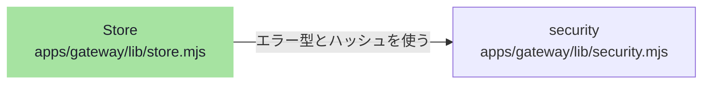

# overall-architecture/gateway/storage-security

[解析トップへ戻る](../../README.md) ・ [ひとつ上へ](../README.md)

単一ノードの SQLite（node:sqlite）に AES-256-GCM で暗号化して保存する。security.mjs は assert / Fault / hash / 入力検証などの共通部品。

## 要素

### security

assert、Fault、hash、text、Twilio 署名など。ほぼすべての lib が使う。

[説明を見る](security/README.md)

### store

put / get / list / tx / audit / enqueue / suppress、キー付きの値。

[説明を見る](store/README.md)
