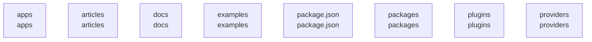

# overall-architecture/group-1

[解析トップへ戻る](../../README.md)

このグループは表示用の区切りです。独立した実行モジュールではありません。

## 要素の説明

### n-apps-802508

確認したパス: `apps`。配下の登録ファイルは163件。

- `apps/desktop/README.md`（一覧のみ）
- `apps/desktop/src-tauri/.gitignore`（一覧のみ）
- `apps/desktop/src-tauri/Cargo.lock`（一覧のみ）
- `apps/desktop/src-tauri/Cargo.toml`（一覧のみ）
- `apps/desktop/src-tauri/build.rs`（一覧のみ）
- `apps/desktop/src-tauri/capabilities/default.json`（一覧のみ）
- `apps/desktop/src-tauri/icons/128x128.png`（一覧のみ）
- `apps/desktop/src-tauri/icons/128x128@2x.png`（一覧のみ）
- `apps/desktop/src-tauri/icons/32x32.png`（一覧のみ）
- `apps/desktop/src-tauri/icons/Square107x107Logo.png`（一覧のみ）
- `apps/desktop/src-tauri/icons/Square142x142Logo.png`（一覧のみ）
- `apps/desktop/src-tauri/icons/Square150x150Logo.png`（一覧のみ）
- `apps/desktop/src-tauri/icons/Square284x284Logo.png`（一覧のみ）
- `apps/desktop/src-tauri/icons/Square30x30Logo.png`（一覧のみ）
- `apps/desktop/src-tauri/icons/Square310x310Logo.png`（一覧のみ）
- `apps/desktop/src-tauri/icons/Square44x44Logo.png`（一覧のみ）
- `apps/desktop/src-tauri/icons/Square71x71Logo.png`（一覧のみ）
- `apps/desktop/src-tauri/icons/Square89x89Logo.png`（一覧のみ）
- `apps/desktop/src-tauri/icons/StoreLogo.png`（一覧のみ）
- `apps/desktop/src-tauri/icons/icon.icns`（一覧のみ）
- `apps/desktop/src-tauri/icons/icon.ico`（一覧のみ）
- `apps/desktop/src-tauri/icons/icon.png`（一覧のみ）
- `apps/desktop/src-tauri/src/lib.rs`（一覧のみ）
- `apps/desktop/src-tauri/src/main.rs`（一覧のみ）
- `apps/desktop/src-tauri/tauri.conf.json`（一覧のみ）
- `apps/desktop/ui/index.html`（一覧のみ）
- `apps/gateway/.env.example`（一覧のみ）
- `apps/gateway/.gitignore`（一覧のみ）
- `apps/gateway/README.md`（一覧のみ）
- `apps/gateway/agent-mcp.mjs`（一覧のみ）
- `apps/gateway/backup.mjs`（一覧のみ）
- `apps/gateway/connect-agent.mjs`（一覧のみ）
- `apps/gateway/demo.mjs`（一覧のみ）
- `apps/gateway/deploy/Caddyfile`（一覧のみ）
- `apps/gateway/deploy/Dockerfile`（一覧のみ）

[詳細な図と説明を見る](n-apps-802508/README.md)

### n-articles-a9d244

確認したパス: `articles`。配下の登録ファイルは7件。

- `articles/agent-team-launch.md`（一覧のみ）
- `articles/ai-meeting-voice-tasks.md`（一覧のみ）
- `articles/genie-mac-workspace.md`（一覧のみ）
- `articles/oathra-evidence-rules.md`（一覧のみ）
- `articles/oathra-five-ways.md`（一覧のみ）
- `articles/oathra-launch.md`（一覧のみ）
- `articles/split-writer-and-reviewer.md`（一覧のみ）

### n-docs-71ab8b

確認したパス: `docs`。配下の登録ファイルは475件。

- `docs/ARCHITECTURE.md`（一覧のみ）
- `docs/DESIGN_RESEARCH.md`（一覧のみ）
- `docs/ENTERPRISE_READINESS.md`（一覧のみ）
- `docs/FIRST_PROOF.md`（一覧のみ）
- `docs/FIRST_RUN.md`（一覧のみ）
- `docs/FRONTLINE.ja.md`（一覧のみ）
- `docs/GOAL.md`（一覧のみ）
- `docs/INTEGRATION.ja.md`（一覧のみ）
- `docs/INTEGRATION.md`（一覧のみ）
- `docs/OMNICHANNEL_SALES.md`（一覧のみ）
- `docs/OUTREACH_2026-09-21.md`（一覧のみ）
- `docs/PLUGINS.ja.md`（一覧のみ）
- `docs/PRODUCT_REVIEW.md`（一覧のみ）
- `docs/READINESS.md`（一覧のみ）
- `docs/SETUP.en.md`（一覧のみ）
- `docs/SETUP.ja.md`（一覧のみ）
- `docs/design/ACCEPTANCE.md`（一覧のみ）
- `docs/design/CONTENT.md`（一覧のみ）
- `docs/design/DESIGN.md`（一覧のみ）
- `docs/design/HERO_VARIANTS.md`（一覧のみ）
- `docs/design/HERO_VARIANTS_V2.md`（一覧のみ）
- `docs/design/PRODUCT.md`（一覧のみ）
- `docs/design/hero-v2/a.html`（一覧のみ）
- `docs/design/hero-v2/b.html`（一覧のみ）
- `docs/design/hero-v2/c.html`（一覧のみ）
- `docs/design/hero-v2/hero.css`（一覧のみ）
- `docs/design/hero-v2/sim.js`（一覧のみ）
- `docs/design/hero-variants-v2.png`（一覧のみ）
- `docs/design/hero-variants.png`（一覧のみ）
- `docs/design/launch-2026-09-14/browser-checks-en.json`（一覧のみ）
- `docs/design/launch-2026-09-14/desktop-en.jpg`（一覧のみ）
- `docs/design/launch-2026-09-14/desktop-ja.jpg`（一覧のみ）
- `docs/design/launch-2026-09-14/mobile-en.jpg`（一覧のみ）
- `docs/design/launch-2026-09-14/mobile-ja.jpg`（一覧のみ）
- `docs/design/ui/SOURCES.md`（一覧のみ）

[詳細な図と説明を見る](n-docs-71ab8b/README.md)

### n-examples-99345c

確認したパス: `examples`。配下の登録ファイルは2件。

- `examples/livekit-evidence.ts`（一覧のみ）
- `examples/verify-recording.mjs`（一覧のみ）

[詳細な図と説明を見る](n-examples-99345c/README.md)

### n-package-json-7030d0

確認したパス: `package.json`。配下の登録ファイルは1件。

- `package.json`（内容確認済み）

### n-packages-d8ae08

確認したパス: `packages`。配下の登録ファイルは110件。

- `packages/cli/package.json`（内容確認済み）
- `packages/cli/src/bin.ts`（一覧のみ）
- `packages/cli/src/brains.ts`（一覧のみ）
- `packages/cli/src/callee.ts`（一覧のみ）
- `packages/cli/src/commands.ts`（一覧のみ）
- `packages/cli/src/evidence.ts`（一覧のみ）
- `packages/cli/src/index.ts`（一覧のみ）
- `packages/cli/src/local-conversation.test.ts`（一覧のみ）
- `packages/cli/src/local-conversation.ts`（一覧のみ）
- `packages/cli/src/mcp.test.ts`（一覧のみ）
- `packages/cli/src/mcp.ts`（一覧のみ）
- `packages/cli/src/paths.ts`（一覧のみ）
- `packages/cli/src/phone.test.ts`（一覧のみ）
- `packages/cli/src/phone.ts`（一覧のみ）
- `packages/cli/src/render.ts`（一覧のみ）
- `packages/cli/src/speaker-lines.ts`（一覧のみ）
- `packages/cli/src/transcript.test.ts`（一覧のみ）
- `packages/cli/src/transcript.ts`（一覧のみ）
- `packages/cli/src/ui.ts`（一覧のみ）
- `packages/cli/tsconfig.json`（一覧のみ）
- `packages/contract/package.json`（内容確認済み）
- `packages/contract/src/contact.ts`（一覧のみ）
- `packages/contract/src/contract.test.ts`（一覧のみ）
- `packages/contract/src/index.ts`（一覧のみ）
- `packages/contract/src/phone-input.test.ts`（一覧のみ）
- `packages/contract/src/phone-input.ts`（一覧のみ）
- `packages/contract/src/phone-templates.test.ts`（一覧のみ）
- `packages/contract/src/phone-templates.ts`（一覧のみ）
- `packages/contract/tsconfig.json`（一覧のみ）
- `packages/core/package.json`（内容確認済み）
- `packages/core/src/adversarial-probe.test.ts`（一覧のみ）
- `packages/core/src/audio.ts`（一覧のみ）
- `packages/core/src/blind-probe.test.ts`（一覧のみ）
- `packages/core/src/checkin-fuzz.test.ts`（一覧のみ）
- `packages/core/src/checkin.test.ts`（一覧のみ）

[詳細な図と説明を見る](n-packages-d8ae08/README.md)

### n-plugins-440c33

確認したパス: `plugins`。配下の登録ファイルは18件。

- `plugins/_shared/http.mjs`（一覧のみ）
- `plugins/calendar/index.mjs`（内容確認済み）
- `plugins/calendar/oathra.plugin.json`（一覧のみ）
- `plugins/call/index.mjs`（内容確認済み）
- `plugins/call/oathra.plugin.json`（一覧のみ）
- `plugins/crm/index.mjs`（一覧のみ）
- `plugins/crm/oathra.plugin.json`（一覧のみ）
- `plugins/email/index.mjs`（一覧のみ）
- `plugins/email/oathra.plugin.json`（一覧のみ）
- `plugins/line/index.mjs`（一覧のみ）
- `plugins/line/oathra.plugin.json`（一覧のみ）
- `plugins/slack/index.mjs`（一覧のみ）
- `plugins/slack/oathra.plugin.json`（一覧のみ）
- `plugins/sms/index.mjs`（一覧のみ）
- `plugins/sms/oathra.plugin.json`（一覧のみ）
- `plugins/telegram/README.md`（一覧のみ）
- `plugins/telegram/index.mjs`（一覧のみ）
- `plugins/telegram/oathra.plugin.json`（一覧のみ）

[詳細な図と説明を見る](n-plugins-440c33/README.md)

### n-providers-d7e351

確認したパス: `providers`。配下の登録ファイルは106件。

- `providers/audio-kit/package.json`（一覧のみ）
- `providers/audio-kit/src/audio-kit.test.ts`（一覧のみ）
- `providers/audio-kit/src/index.ts`（一覧のみ）
- `providers/audio-kit/tsconfig.json`（一覧のみ）
- `providers/brain-kit/package.json`（一覧のみ）
- `providers/brain-kit/src/brain-kit.test.ts`（一覧のみ）
- `providers/brain-kit/src/index.ts`（一覧のみ）
- `providers/brain-kit/tsconfig.json`（一覧のみ）
- `providers/deepgram/package.json`（一覧のみ）
- `providers/deepgram/src/deepgram.test.ts`（一覧のみ）
- `providers/deepgram/src/index.ts`（一覧のみ）
- `providers/deepgram/tsconfig.json`（一覧のみ）
- `providers/gateway-livekit/package.json`（一覧のみ）
- `providers/gateway-livekit/src/gateway.test.ts`（一覧のみ）
- `providers/gateway-livekit/src/index.ts`（一覧のみ）
- `providers/gateway-livekit/src/rtc.ts`（一覧のみ）
- `providers/gateway-livekit/tsconfig.json`（一覧のみ）
- `providers/gemini-live/package.json`（一覧のみ）
- `providers/gemini-live/src/engines.test.ts`（一覧のみ）
- `providers/gemini-live/src/engines.ts`（一覧のみ）
- `providers/gemini-live/src/index.ts`（一覧のみ）
- `providers/gemini-live/src/live.test.ts`（一覧のみ）
- `providers/gemini-live/src/live.ts`（一覧のみ）
- `providers/gemini-live/src/resume.test.ts`（一覧のみ）
- `providers/gemini-live/tsconfig.json`（一覧のみ）
- `providers/gemini/package.json`（一覧のみ）
- `providers/gemini/src/gemini.test.ts`（一覧のみ）
- `providers/gemini/src/index.ts`（一覧のみ）
- `providers/gemini/src/tts.test.ts`（一覧のみ）
- `providers/gemini/src/tts.ts`（一覧のみ）
- `providers/gemini/tsconfig.json`（一覧のみ）
- `providers/ollama/package.json`（一覧のみ）
- `providers/ollama/src/index.ts`（一覧のみ）
- `providers/ollama/src/ollama.test.ts`（一覧のみ）
- `providers/ollama/tsconfig.json`（一覧のみ）

[詳細な図と説明を見る](n-providers-d7e351/README.md)

