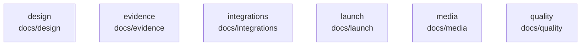

# overall-architecture/group-1/n-docs-71ab8b

[解析トップへ戻る](../../../README.md)

確認したパス: `docs`。配下の登録ファイルは475件。

- `docs/ARCHITECTURE.md`（一覧のみ）
- `docs/DESIGN_RESEARCH.md`（一覧のみ）
- `docs/ENTERPRISE_READINESS.md`（一覧のみ）
- `docs/FIRST_PROOF.md`（一覧のみ）
- `docs/FIRST_RUN.md`（一覧のみ）
- `docs/FRONTLINE.ja.md`（一覧のみ）
- `docs/GOAL.md`（一覧のみ）
- `docs/INTEGRATION.ja.md`（一覧のみ）
- `docs/INTEGRATION.md`（一覧のみ）
- `docs/OMNICHANNEL_SALES.md`（一覧のみ）
- `docs/OUTREACH_2026-09-21.md`（一覧のみ）
- `docs/PLUGINS.ja.md`（一覧のみ）
- `docs/PRODUCT_REVIEW.md`（一覧のみ）
- `docs/READINESS.md`（一覧のみ）
- `docs/SETUP.en.md`（一覧のみ）
- `docs/SETUP.ja.md`（一覧のみ）
- `docs/design/ACCEPTANCE.md`（一覧のみ）
- `docs/design/CONTENT.md`（一覧のみ）
- `docs/design/DESIGN.md`（一覧のみ）
- `docs/design/HERO_VARIANTS.md`（一覧のみ）
- `docs/design/HERO_VARIANTS_V2.md`（一覧のみ）
- `docs/design/PRODUCT.md`（一覧のみ）
- `docs/design/hero-v2/a.html`（一覧のみ）
- `docs/design/hero-v2/b.html`（一覧のみ）
- `docs/design/hero-v2/c.html`（一覧のみ）
- `docs/design/hero-v2/hero.css`（一覧のみ）
- `docs/design/hero-v2/sim.js`（一覧のみ）
- `docs/design/hero-variants-v2.png`（一覧のみ）
- `docs/design/hero-variants.png`（一覧のみ）
- `docs/design/launch-2026-09-14/browser-checks-en.json`（一覧のみ）
- `docs/design/launch-2026-09-14/desktop-en.jpg`（一覧のみ）
- `docs/design/launch-2026-09-14/desktop-ja.jpg`（一覧のみ）
- `docs/design/launch-2026-09-14/mobile-en.jpg`（一覧のみ）
- `docs/design/launch-2026-09-14/mobile-ja.jpg`（一覧のみ）
- `docs/design/ui/SOURCES.md`（一覧のみ）

## 要素の説明

### n-docs-design-f63999

実在パス: `docs/design`。25ファイル。

- `docs/design/ACCEPTANCE.md`
- `docs/design/CONTENT.md`
- `docs/design/DESIGN.md`
- `docs/design/HERO_VARIANTS.md`
- `docs/design/HERO_VARIANTS_V2.md`
- `docs/design/PRODUCT.md`
- `docs/design/hero-v2/a.html`
- `docs/design/hero-v2/b.html`
- `docs/design/hero-v2/c.html`
- `docs/design/hero-v2/hero.css`
- `docs/design/hero-v2/sim.js`
- `docs/design/hero-variants-v2.png`
- `docs/design/hero-variants.png`
- `docs/design/launch-2026-09-14/browser-checks-en.json`
- `docs/design/launch-2026-09-14/desktop-en.jpg`
- `docs/design/launch-2026-09-14/desktop-ja.jpg`
- `docs/design/launch-2026-09-14/mobile-en.jpg`
- `docs/design/launch-2026-09-14/mobile-ja.jpg`
- `docs/design/ui/SOURCES.md`
- `docs/design/ui/acceptance.md`
- `docs/design/ui/brief-arena.md`
- `docs/design/ui/brief-gateway.md`
- `docs/design/ui/references/README.md`
- `docs/design/ui/report-template.md`
- `docs/design/ui/tokens.md`

### n-docs-evidence-3d7bf7

実在パス: `docs/evidence`。4ファイル。

- `docs/evidence/adversarial-20260913.json`
- `docs/evidence/provisional-before-summary.json`
- `docs/evidence/repeat-20260913.json`
- `docs/evidence/repeat-20260913.log`

### n-docs-integrations-dfe281

実在パス: `docs/integrations`。2ファイル。

- `docs/integrations/claude-chatgpt.md`
- `docs/integrations/multibot.md`

### n-docs-launch-5a3e7e

実在パス: `docs/launch`。81ファイル。

- `docs/launch/2026-09-14.md`
- `docs/launch/devto-evidence-rules.md`
- `docs/launch/devto-five-ways.md`
- `docs/launch/devto-oathra-launch.md`
- `docs/launch/github-package-0.1.1.md`
- `docs/launch/growth-loop.md`
- `docs/launch/livekit-show-and-tell-draft.md`
- `docs/launch/metrics.md`
- `docs/launch/metrics/2026-09-14-1232-jst.json`
- `docs/launch/metrics/2026-09-14-1239-jst.json`
- `docs/launch/metrics/2026-09-14-1249-jst.json`
- `docs/launch/metrics/2026-09-14-1256-jst.json`
- `docs/launch/metrics/2026-09-14-1316-jst.json`
- `docs/launch/metrics/2026-09-14-1332-jst.json`
- `docs/launch/metrics/2026-09-14-1357-jst.json`
- `docs/launch/metrics/2026-09-14-1410-jst.json`
- `docs/launch/metrics/2026-09-14-1445-jst.json`
- `docs/launch/metrics/2026-09-14-1500-jst.json`
- `docs/launch/metrics/2026-09-14-1545-jst.json`
- `docs/launch/metrics/2026-09-14-1555-jst.json`
- `docs/launch/metrics/2026-09-14-1605-jst.json`
- `docs/launch/metrics/2026-09-14-1712-jst.json`
- `docs/launch/metrics/2026-09-14-1735-jst.json`
- `docs/launch/metrics/2026-09-14-1756-jst.json`
- `docs/launch/metrics/2026-09-14-1819-jst.json`

### n-docs-media-17908a

実在パス: `docs/media`。49ファイル。

- `docs/media/arena-confirmed.png`
- `docs/media/arena-negotiating.png`
- `docs/media/battle-impossible-hotel.png`
- `docs/media/battle-impossible-hotel.svg`
- `docs/media/oathra-battle-en-poster.png`
- `docs/media/oathra-battle-en-square.mp4`
- `docs/media/oathra-battle-en-vertical.mp4`
- `docs/media/oathra-battle-en.gif`
- `docs/media/oathra-battle-en.mp4`
- `docs/media/oathra-battle-ja-poster.png`
- `docs/media/oathra-battle-ja-square.mp4`
- `docs/media/oathra-battle-ja-vertical.mp4`
- `docs/media/oathra-battle-ja.gif`
- `docs/media/oathra-battle-ja.mp4`
- `docs/media/oathra-evidence-en-poster.jpg`
- `docs/media/oathra-evidence-en.mp4`
- `docs/media/oathra-evidence-en.vtt`
- `docs/media/oathra-evidence-ja-poster.jpg`
- `docs/media/oathra-evidence-ja.mp4`
- `docs/media/oathra-evidence-ja.vtt`
- `docs/media/oathra-intake-en.vtt`
- `docs/media/oathra-intake-ja-poster.png`
- `docs/media/oathra-intake-ja-square.mp4`
- `docs/media/oathra-intake-ja.gif`
- `docs/media/oathra-intake-ja.mp4`

### n-docs-quality-8a58ae

実在パス: `docs/quality`。298ファイル。

- `docs/quality/app-craft.md`
- `docs/quality/arena-contract.md`
- `docs/quality/award-craft.md`
- `docs/quality/call-credit-usage.md`
- `docs/quality/call-duration.md`
- `docs/quality/call-opening.md`
- `docs/quality/chat-news.md`
- `docs/quality/credit-cutoff.md`
- `docs/quality/credit-purchases.md`
- `docs/quality/easy-phone.md`
- `docs/quality/email-login.md`
- `docs/quality/evidence/2026-10-02-app-craft/account-binding-review.json`
- `docs/quality/evidence/2026-10-02-app-craft/account-binding-review.md`
- `docs/quality/evidence/2026-10-02-app-craft/account-binding-review.mjs`
- `docs/quality/evidence/2026-10-02-app-craft/app-accessibility-narrow.json`
- `docs/quality/evidence/2026-10-02-app-craft/app-accessibility-narrow.mjs`
- `docs/quality/evidence/2026-10-02-app-craft/app-independent-interactions-after.json`
- `docs/quality/evidence/2026-10-02-app-craft/app-independent-interactions-final.json`
- `docs/quality/evidence/2026-10-02-app-craft/app-independent-interactions.json`
- `docs/quality/evidence/2026-10-02-app-craft/app-independent-interactions.mjs`
- `docs/quality/evidence/2026-10-02-app-craft/app-route-review.mjs`
- `docs/quality/evidence/2026-10-02-app-craft/author-new-safari-desktop.png`
- `docs/quality/evidence/2026-10-02-app-craft/author-new-safari-round-b-390.png`
- `docs/quality/evidence/2026-10-02-app-craft/author-products-safari-390.png`
- `docs/quality/evidence/2026-10-02-app-craft/author-ui-review.json`

