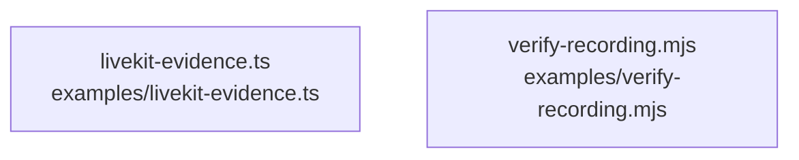

# overall-architecture/group-1/n-examples-99345c

[解析トップへ戻る](../../../README.md)

確認したパス: `examples`。配下の登録ファイルは2件。

- `examples/livekit-evidence.ts`（一覧のみ）
- `examples/verify-recording.mjs`（一覧のみ）

## 要素の説明

### n-examples-livekit-evidence-ts-a2d753

実在パス: `examples/livekit-evidence.ts`。1ファイル。

- `examples/livekit-evidence.ts`

### n-examples-verify-recording-mjs-8726ae

実在パス: `examples/verify-recording.mjs`。1ファイル。

- `examples/verify-recording.mjs`

