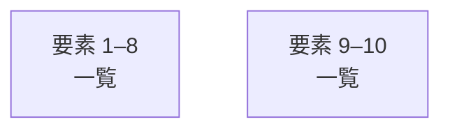

# overall-architecture/group-1/n-packages-d8ae08

[解析トップへ戻る](../../../README.md)

確認したパス: `packages`。配下の登録ファイルは110件。

- `packages/cli/package.json`（内容確認済み）
- `packages/cli/src/bin.ts`（一覧のみ）
- `packages/cli/src/brains.ts`（一覧のみ）
- `packages/cli/src/callee.ts`（一覧のみ）
- `packages/cli/src/commands.ts`（一覧のみ）
- `packages/cli/src/evidence.ts`（一覧のみ）
- `packages/cli/src/index.ts`（一覧のみ）
- `packages/cli/src/local-conversation.test.ts`（一覧のみ）
- `packages/cli/src/local-conversation.ts`（一覧のみ）
- `packages/cli/src/mcp.test.ts`（一覧のみ）
- `packages/cli/src/mcp.ts`（一覧のみ）
- `packages/cli/src/paths.ts`（一覧のみ）
- `packages/cli/src/phone.test.ts`（一覧のみ）
- `packages/cli/src/phone.ts`（一覧のみ）
- `packages/cli/src/render.ts`（一覧のみ）
- `packages/cli/src/speaker-lines.ts`（一覧のみ）
- `packages/cli/src/transcript.test.ts`（一覧のみ）
- `packages/cli/src/transcript.ts`（一覧のみ）
- `packages/cli/src/ui.ts`（一覧のみ）
- `packages/cli/tsconfig.json`（一覧のみ）
- `packages/contract/package.json`（内容確認済み）
- `packages/contract/src/contact.ts`（一覧のみ）
- `packages/contract/src/contract.test.ts`（一覧のみ）
- `packages/contract/src/index.ts`（一覧のみ）
- `packages/contract/src/phone-input.test.ts`（一覧のみ）
- `packages/contract/src/phone-input.ts`（一覧のみ）
- `packages/contract/src/phone-templates.test.ts`（一覧のみ）
- `packages/contract/src/phone-templates.ts`（一覧のみ）
- `packages/contract/tsconfig.json`（一覧のみ）
- `packages/core/package.json`（内容確認済み）
- `packages/core/src/adversarial-probe.test.ts`（一覧のみ）
- `packages/core/src/audio.ts`（一覧のみ）
- `packages/core/src/blind-probe.test.ts`（一覧のみ）
- `packages/core/src/checkin-fuzz.test.ts`（一覧のみ）
- `packages/core/src/checkin.test.ts`（一覧のみ）

## 要素の説明

### group-1

このグループは表示用の区切りです。独立した実行モジュールではありません。

[詳細な図と説明を見る](group-1/README.md)

### group-2

このグループは表示用の区切りです。独立した実行モジュールではありません。

[詳細な図と説明を見る](group-2/README.md)

