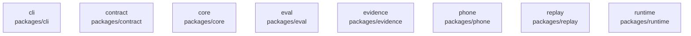

# overall-architecture/group-1/n-packages-d8ae08/group-1

[解析トップへ戻る](../../../../README.md)

このグループは表示用の区切りです。独立した実行モジュールではありません。

## 要素の説明

### n-packages-cli-5a4e3b

実在パス: `packages/cli`。20ファイル。

- `packages/cli/package.json`
- `packages/cli/src/bin.ts`
- `packages/cli/src/brains.ts`
- `packages/cli/src/callee.ts`
- `packages/cli/src/commands.ts`
- `packages/cli/src/evidence.ts`
- `packages/cli/src/index.ts`
- `packages/cli/src/local-conversation.test.ts`
- `packages/cli/src/local-conversation.ts`
- `packages/cli/src/mcp.test.ts`
- `packages/cli/src/mcp.ts`
- `packages/cli/src/paths.ts`
- `packages/cli/src/phone.test.ts`
- `packages/cli/src/phone.ts`
- `packages/cli/src/render.ts`
- `packages/cli/src/speaker-lines.ts`
- `packages/cli/src/transcript.test.ts`
- `packages/cli/src/transcript.ts`
- `packages/cli/src/ui.ts`
- `packages/cli/tsconfig.json`

### n-packages-contract-7643ef

実在パス: `packages/contract`。9ファイル。

- `packages/contract/package.json`
- `packages/contract/src/contact.ts`
- `packages/contract/src/contract.test.ts`
- `packages/contract/src/index.ts`
- `packages/contract/src/phone-input.test.ts`
- `packages/contract/src/phone-input.ts`
- `packages/contract/src/phone-templates.test.ts`
- `packages/contract/src/phone-templates.ts`
- `packages/contract/tsconfig.json`

### n-packages-core-2e6905

実在パス: `packages/core`。23ファイル。

- `packages/core/package.json`
- `packages/core/src/adversarial-probe.test.ts`
- `packages/core/src/audio.ts`
- `packages/core/src/blind-probe.test.ts`
- `packages/core/src/checkin-fuzz.test.ts`
- `packages/core/src/checkin.test.ts`
- `packages/core/src/checkin.ts`
- `packages/core/src/core.test.ts`
- `packages/core/src/distress.test.ts`
- `packages/core/src/distress.ts`
- `packages/core/src/events.ts`
- `packages/core/src/index.ts`
- `packages/core/src/phone-memory.test.ts`
- `packages/core/src/phone-memory.ts`
- `packages/core/src/providers.ts`
- `packages/core/src/reservation-desk.test.ts`
- `packages/core/src/reservation-desk.ts`
- `packages/core/src/speech.ts`
- `packages/core/src/state.ts`
- `packages/core/src/trace.ts`
- `packages/core/src/voicemail.test.ts`
- `packages/core/src/voicemail.ts`
- `packages/core/tsconfig.json`

### n-packages-eval-c84ff5

実在パス: `packages/eval`。6ファイル。

- `packages/eval/package.json`
- `packages/eval/src/adversarial.ts`
- `packages/eval/src/eval.test.ts`
- `packages/eval/src/index.ts`
- `packages/eval/src/restaurant-two-sided.test.ts`
- `packages/eval/tsconfig.json`

### n-packages-evidence-b6c51f

実在パス: `packages/evidence`。24ファイル。

- `packages/evidence/package.json`
- `packages/evidence/src/adversarial-probe.test.ts`
- `packages/evidence/src/appointment-fuzz.test.ts`
- `packages/evidence/src/appointment.test.ts`
- `packages/evidence/src/blind-probe.test.ts`
- `packages/evidence/src/blind-set-a.test.ts`
- `packages/evidence/src/blind-set-b.test.ts`
- `packages/evidence/src/blind-set-c.test.ts`
- `packages/evidence/src/engine.ts`
- `packages/evidence/src/evaluate.ts`
- `packages/evidence/src/evidence.test.ts`
- `packages/evidence/src/extract.ts`
- `packages/evidence/src/fuzz.test.ts`
- `packages/evidence/src/index.ts`
- `packages/evidence/src/normalize.ts`
- `packages/evidence/src/proof.test.ts`
- `packages/evidence/src/proof.ts`
- `packages/evidence/src/provisional.test.ts`
- `packages/evidence/src/quantity-fuzz.test.ts`
- `packages/evidence/src/quantity.test.ts`
- `packages/evidence/src/shape.ts`
- `packages/evidence/src/types.ts`
- `packages/evidence/src/widened-shapes.test.ts`
- `packages/evidence/tsconfig.json`

### n-packages-phone-989d62

実在パス: `packages/phone`。11ファイル。

- `packages/phone/package.json`
- `packages/phone/src/bridge.test.ts`
- `packages/phone/src/bridge.ts`
- `packages/phone/src/config.ts`
- `packages/phone/src/doctor.ts`
- `packages/phone/src/index.ts`
- `packages/phone/src/pricing.ts`
- `packages/phone/src/registry.ts`
- `packages/phone/src/routing.test.ts`
- `packages/phone/src/types.ts`
- `packages/phone/tsconfig.json`

### n-packages-replay-65d34a

実在パス: `packages/replay`。4ファイル。

- `packages/replay/package.json`
- `packages/replay/src/index.ts`
- `packages/replay/src/replay.test.ts`
- `packages/replay/tsconfig.json`

### n-packages-runtime-d76308

実在パス: `packages/runtime`。4ファイル。

- `packages/runtime/package.json`
- `packages/runtime/src/index.ts`
- `packages/runtime/src/runtime.test.ts`
- `packages/runtime/tsconfig.json`

