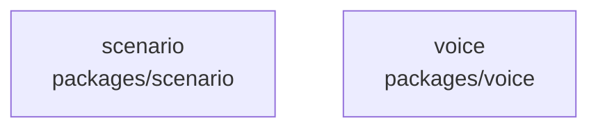

# overall-architecture/group-1/n-packages-d8ae08/group-2

[解析トップへ戻る](../../../../README.md)

このグループは表示用の区切りです。独立した実行モジュールではありません。

## 要素の説明

### n-packages-scenario-67b4b1

実在パス: `packages/scenario`。5ファイル。

- `packages/scenario/package.json`
- `packages/scenario/src/index.test.ts`
- `packages/scenario/src/index.ts`
- `packages/scenario/src/schema.ts`
- `packages/scenario/tsconfig.json`

### n-packages-voice-e89d52

実在パス: `packages/voice`。4ファイル。

- `packages/voice/package.json`
- `packages/voice/src/index.ts`
- `packages/voice/src/voice.test.ts`
- `packages/voice/tsconfig.json`

