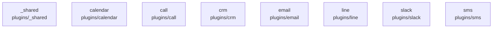

# overall-architecture/group-1/n-plugins-440c33/group-1

[解析トップへ戻る](../../../../README.md)

このグループは表示用の区切りです。独立した実行モジュールではありません。

## 要素の説明

### n-plugins-calendar-e02f0f

実在パス: `plugins/calendar`。2ファイル。

- `plugins/calendar/index.mjs`
- `plugins/calendar/oathra.plugin.json`

### n-plugins-call-c0cda2

実在パス: `plugins/call`。2ファイル。

- `plugins/call/index.mjs`
- `plugins/call/oathra.plugin.json`

### n-plugins-crm-1d27af

実在パス: `plugins/crm`。2ファイル。

- `plugins/crm/index.mjs`
- `plugins/crm/oathra.plugin.json`

### n-plugins-email-6b362b

実在パス: `plugins/email`。2ファイル。

- `plugins/email/index.mjs`
- `plugins/email/oathra.plugin.json`

### n-plugins-line-71c40e

実在パス: `plugins/line`。2ファイル。

- `plugins/line/index.mjs`
- `plugins/line/oathra.plugin.json`

### n-plugins-shared-525af1

実在パス: `plugins/_shared`。1ファイル。

- `plugins/_shared/http.mjs`

### n-plugins-slack-cb3e89

実在パス: `plugins/slack`。2ファイル。

- `plugins/slack/index.mjs`
- `plugins/slack/oathra.plugin.json`

### n-plugins-sms-43ca56

実在パス: `plugins/sms`。2ファイル。

- `plugins/sms/index.mjs`
- `plugins/sms/oathra.plugin.json`

