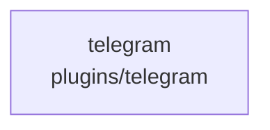

# overall-architecture/group-1/n-plugins-440c33/group-2

[解析トップへ戻る](../../../../README.md)

このグループは表示用の区切りです。独立した実行モジュールではありません。

## 要素の説明

### n-plugins-telegram-5cf95c

実在パス: `plugins/telegram`。3ファイル。

- `plugins/telegram/README.md`
- `plugins/telegram/index.mjs`
- `plugins/telegram/oathra.plugin.json`

