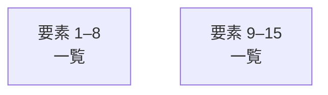

# overall-architecture/group-1/n-providers-d7e351

[解析トップへ戻る](../../../README.md)

確認したパス: `providers`。配下の登録ファイルは106件。

- `providers/audio-kit/package.json`（一覧のみ）
- `providers/audio-kit/src/audio-kit.test.ts`（一覧のみ）
- `providers/audio-kit/src/index.ts`（一覧のみ）
- `providers/audio-kit/tsconfig.json`（一覧のみ）
- `providers/brain-kit/package.json`（一覧のみ）
- `providers/brain-kit/src/brain-kit.test.ts`（一覧のみ）
- `providers/brain-kit/src/index.ts`（一覧のみ）
- `providers/brain-kit/tsconfig.json`（一覧のみ）
- `providers/deepgram/package.json`（一覧のみ）
- `providers/deepgram/src/deepgram.test.ts`（一覧のみ）
- `providers/deepgram/src/index.ts`（一覧のみ）
- `providers/deepgram/tsconfig.json`（一覧のみ）
- `providers/gateway-livekit/package.json`（一覧のみ）
- `providers/gateway-livekit/src/gateway.test.ts`（一覧のみ）
- `providers/gateway-livekit/src/index.ts`（一覧のみ）
- `providers/gateway-livekit/src/rtc.ts`（一覧のみ）
- `providers/gateway-livekit/tsconfig.json`（一覧のみ）
- `providers/gemini-live/package.json`（一覧のみ）
- `providers/gemini-live/src/engines.test.ts`（一覧のみ）
- `providers/gemini-live/src/engines.ts`（一覧のみ）
- `providers/gemini-live/src/index.ts`（一覧のみ）
- `providers/gemini-live/src/live.test.ts`（一覧のみ）
- `providers/gemini-live/src/live.ts`（一覧のみ）
- `providers/gemini-live/src/resume.test.ts`（一覧のみ）
- `providers/gemini-live/tsconfig.json`（一覧のみ）
- `providers/gemini/package.json`（一覧のみ）
- `providers/gemini/src/gemini.test.ts`（一覧のみ）
- `providers/gemini/src/index.ts`（一覧のみ）
- `providers/gemini/src/tts.test.ts`（一覧のみ）
- `providers/gemini/src/tts.ts`（一覧のみ）
- `providers/gemini/tsconfig.json`（一覧のみ）
- `providers/ollama/package.json`（一覧のみ）
- `providers/ollama/src/index.ts`（一覧のみ）
- `providers/ollama/src/ollama.test.ts`（一覧のみ）
- `providers/ollama/tsconfig.json`（一覧のみ）

## 要素の説明

### group-1

このグループは表示用の区切りです。独立した実行モジュールではありません。

[詳細な図と説明を見る](group-1/README.md)

### group-2

このグループは表示用の区切りです。独立した実行モジュールではありません。

[詳細な図と説明を見る](group-2/README.md)

