# overall-architecture/group-1/n-providers-d7e351/group-1

[解析トップへ戻る](../../../../README.md)

このグループは表示用の区切りです。独立した実行モジュールではありません。

```mermaid
graph TD
    n-providers-audio-kit-2f259f["audio-kit\nproviders/audio-kit"]
    n-providers-brain-kit-706f11["brain-kit\nproviders/brain-kit"]
    n-providers-deepgram-1ea244["deepgram\nproviders/deepgram"]
    n-providers-gateway-livekit-462af5["gateway-livekit\nproviders/gateway-livekit"]
    n-providers-gemini-live-4ab7d4["gemini-live\nproviders/gemini-live"]
    n-providers-gemini-75e95c["gemini\nproviders/gemini"]
    n-providers-ollama-9e72f0["ollama\nproviders/ollama"]
    n-providers-openai-realtime-1174d5["openai-realtime\nproviders/openai-realtime"]
```

## 要素の説明

### n-providers-audio-kit-2f259f

実在パス: `providers/audio-kit`。4ファイル。

- `providers/audio-kit/package.json`
- `providers/audio-kit/src/audio-kit.test.ts`
- `providers/audio-kit/src/index.ts`
- `providers/audio-kit/tsconfig.json`

### n-providers-brain-kit-706f11

実在パス: `providers/brain-kit`。4ファイル。

- `providers/brain-kit/package.json`
- `providers/brain-kit/src/brain-kit.test.ts`
- `providers/brain-kit/src/index.ts`
- `providers/brain-kit/tsconfig.json`

### n-providers-deepgram-1ea244

実在パス: `providers/deepgram`。4ファイル。

- `providers/deepgram/package.json`
- `providers/deepgram/src/deepgram.test.ts`
- `providers/deepgram/src/index.ts`
- `providers/deepgram/tsconfig.json`

### n-providers-gateway-livekit-462af5

実在パス: `providers/gateway-livekit`。5ファイル。

- `providers/gateway-livekit/package.json`
- `providers/gateway-livekit/src/gateway.test.ts`
- `providers/gateway-livekit/src/index.ts`
- `providers/gateway-livekit/src/rtc.ts`
- `providers/gateway-livekit/tsconfig.json`

### n-providers-gemini-75e95c

実在パス: `providers/gemini`。6ファイル。

- `providers/gemini/package.json`
- `providers/gemini/src/gemini.test.ts`
- `providers/gemini/src/index.ts`
- `providers/gemini/src/tts.test.ts`
- `providers/gemini/src/tts.ts`
- `providers/gemini/tsconfig.json`

### n-providers-gemini-live-4ab7d4

実在パス: `providers/gemini-live`。8ファイル。

- `providers/gemini-live/package.json`
- `providers/gemini-live/src/engines.test.ts`
- `providers/gemini-live/src/engines.ts`
- `providers/gemini-live/src/index.ts`
- `providers/gemini-live/src/live.test.ts`
- `providers/gemini-live/src/live.ts`
- `providers/gemini-live/src/resume.test.ts`
- `providers/gemini-live/tsconfig.json`

### n-providers-ollama-9e72f0

実在パス: `providers/ollama`。4ファイル。

- `providers/ollama/package.json`
- `providers/ollama/src/index.ts`
- `providers/ollama/src/ollama.test.ts`
- `providers/ollama/tsconfig.json`

### n-providers-openai-realtime-1174d5

実在パス: `providers/openai-realtime`。14ファイル。

- `providers/openai-realtime/package.json`
- `providers/openai-realtime/scripts/live-handshake.mjs`
- `providers/openai-realtime/scripts/live-loopback.mjs`
- `providers/openai-realtime/src/decision.test.ts`
- `providers/openai-realtime/src/engines.test.ts`
- `providers/openai-realtime/src/engines.ts`
- `providers/openai-realtime/src/index.ts`
- `providers/openai-realtime/src/live.test.ts`
- `providers/openai-realtime/src/live.ts`
- `providers/openai-realtime/src/news.test.ts`
- `providers/openai-realtime/src/news.ts`
- `providers/openai-realtime/src/phone-message.test.ts`
- `providers/openai-realtime/src/reception.test.ts`
- `providers/openai-realtime/tsconfig.json`

