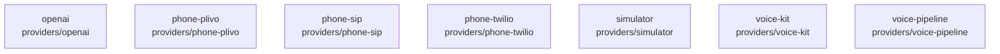

# overall-architecture/group-1/n-providers-d7e351/group-2

[解析トップへ戻る](../../../../README.md)

このグループは表示用の区切りです。独立した実行モジュールではありません。

## 要素の説明

### n-providers-openai-ed6e93

実在パス: `providers/openai`。5ファイル。

- `providers/openai/package.json`
- `providers/openai/src/index.ts`
- `providers/openai/src/openai.test.ts`
- `providers/openai/src/tts.ts`
- `providers/openai/tsconfig.json`

### n-providers-phone-plivo-155e71

実在パス: `providers/phone-plivo`。4ファイル。

- `providers/phone-plivo/package.json`
- `providers/phone-plivo/src/index.ts`
- `providers/phone-plivo/src/plivo.test.ts`
- `providers/phone-plivo/tsconfig.json`

### n-providers-phone-sip-e04349

実在パス: `providers/phone-sip`。4ファイル。

- `providers/phone-sip/package.json`
- `providers/phone-sip/src/index.ts`
- `providers/phone-sip/src/sip.test.ts`
- `providers/phone-sip/tsconfig.json`

### n-providers-phone-twilio-b21809

実在パス: `providers/phone-twilio`。7ファイル。

- `providers/phone-twilio/package.json`
- `providers/phone-twilio/src/index.ts`
- `providers/phone-twilio/src/provider.test.ts`
- `providers/phone-twilio/src/provider.ts`
- `providers/phone-twilio/src/transport.test.ts`
- `providers/phone-twilio/src/transport.ts`
- `providers/phone-twilio/tsconfig.json`

### n-providers-simulator-b0187a

実在パス: `providers/simulator`。17ファイル。

- `providers/simulator/package.json`
- `providers/simulator/src/agent.ts`
- `providers/simulator/src/character.ts`
- `providers/simulator/src/characters/friend.test.ts`
- `providers/simulator/src/characters/friend.ts`
- `providers/simulator/src/characters/hotel.ts`
- `providers/simulator/src/characters/index.ts`
- `providers/simulator/src/characters/llm.test.ts`
- `providers/simulator/src/characters/llm.ts`
- `providers/simulator/src/characters/restaurant.ts`
- `providers/simulator/src/characters/serial.ts`
- `providers/simulator/src/characters/shop.ts`
- `providers/simulator/src/index.ts`
- `providers/simulator/src/rng.ts`
- `providers/simulator/src/simulator.test.ts`
- `providers/simulator/src/transport.ts`
- `providers/simulator/tsconfig.json`

### n-providers-voice-kit-eb2cf6

実在パス: `providers/voice-kit`。16ファイル。

- `providers/voice-kit/package.json`
- `providers/voice-kit/src/call-instructions.test.ts`
- `providers/voice-kit/src/call-instructions.ts`
- `providers/voice-kit/src/concern.test.ts`
- `providers/voice-kit/src/concern.ts`
- `providers/voice-kit/src/decision.test.ts`
- `providers/voice-kit/src/decision.ts`
- `providers/voice-kit/src/index.ts`
- `providers/voice-kit/src/phone-message.test.ts`
- `providers/voice-kit/src/phone-message.ts`
- `providers/voice-kit/src/reception.ts`
- `providers/voice-kit/src/s2s-session.ts`
- `providers/voice-kit/src/text-brain.ts`
- `providers/voice-kit/src/voice-setting.test.ts`
- `providers/voice-kit/src/voice-setting.ts`
- `providers/voice-kit/tsconfig.json`

### n-providers-voice-pipeline-18b842

実在パス: `providers/voice-pipeline`。4ファイル。

- `providers/voice-pipeline/package.json`
- `providers/voice-pipeline/src/index.ts`
- `providers/voice-pipeline/src/pipeline.test.ts`
- `providers/voice-pipeline/tsconfig.json`

